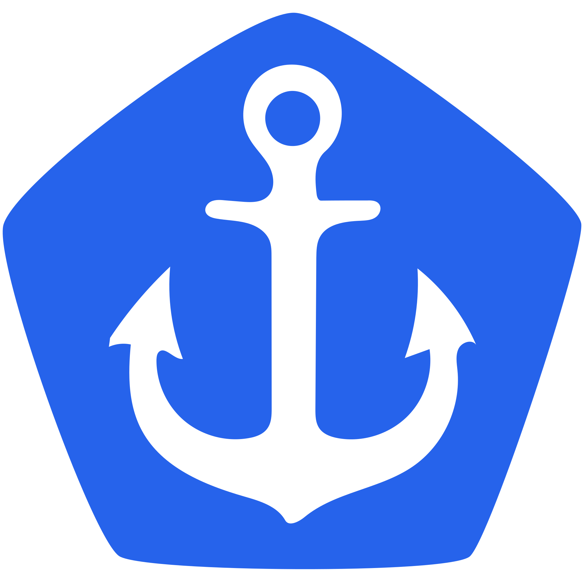
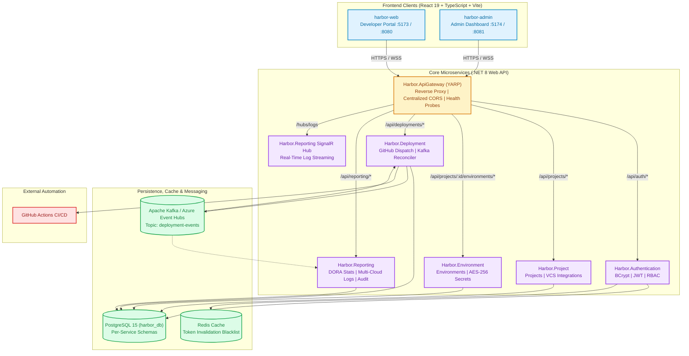

<p align="center">
  
</p>

<h1 align="center">Harbor</h1>

<p align="center">
  <strong>Enterprise-Grade Microservices Deployment & Environment Management Platform</strong>
</p>

<p align="center">
  
  
  
  
  
  
  <a href="docs/testing/coverage/code-coverage.md"></a>
  <a href="docs/testing/execution/test-results.md"></a>
  <a href="docs/testing/defects/defect-log.md"></a>
</p>

---

Harbor is a unified microservices deployment and environment orchestration platform. It empowers engineering organizations to register applications, provision multi-stage environments (`Development`, `Staging`, `Production`), store versioned configurations with AES-256-GCM secret encryption, trigger automated CI/CD runs via GitHub Actions, stream live execution logs over SignalR WebSockets, decouple lifecycle events through Apache Kafka and Azure Event Hubs, and generate cross-service audit and DORA metric reports.

> [!IMPORTANT]
> **SE3112: Advanced Software Engineering — Microservice Testing Pipeline**  
> Complete documentation for the automated testing pipeline, individual feature ownership, tool setup, pipeline commands, and 12-minute viva presentation schedule is published in **[`docs/testing/MICROSERVICE_TESTING_PIPELINE.md`](docs/testing/MICROSERVICE_TESTING_PIPELINE.md)**.
>
> ```bash
> # Run the complete unified 4-layer testing pipeline in one command
> ./scripts/run-testing-pipeline.sh --all
> ```

> [!NOTE]
> **Academic Case Study Context:** Harbor is built as an academic microservices case study (SE3022) delivered across four sprints. Formal QA artifacts (test strategy, test plans, sprint QA reports) are published in [`docs/testing/`](docs/testing/README.md).

> [!TIP]
> Jump directly to the **[Master Documentation Portal](docs/README.md)** for exhaustive architectural runbooks, API contracts, database schemas, and QA reports.

---

## Table of Contents

- [Architecture Overview](#architecture-overview)
- [Key Platform Capabilities](#key-platform-capabilities)
- [Tech Stack](#tech-stack)
- [Repository Structure](#repository-structure)
- [Getting Started](#getting-started)
- [Configuration Reference](#configuration-reference)
- [Services & Ports](#services--ports)
- [API Reference](#api-reference)
- [Data Model](#data-model)
- [Frontend Applications](#frontend-applications)
- [Security Notes](#security-notes)
- [Testing Strategy](#testing-strategy)
- [CI/CD Pipelines](#cicd-pipelines)
- [Frontend–Backend Integration Verification](#frontendbackend-integration-verification)
- [Architecture & Implementation Decisions](#architecture--implementation-decisions)
- [Known Limitations & Roadmap](#known-limitations--roadmap)
- [Documentation Maintenance](#documentation-maintenance)
- [Documentation Index](#documentation-index)

---

## Architecture Overview

Harbor follows an event-driven, decoupled **microservices architecture**: one ASP.NET Core Web API per business domain, fronted by a single YARP API Gateway, with two independent React SPAs as clients.

<p align="center">
  
</p>

<details>
  <summary><b>🔍 View Mermaid Diagram Source</b></summary>



</details>

### Key Architectural Pillars

- **Unified Gateway Ingress**: `Harbor.ApiGateway` is the **exclusive public entry point** for all frontends. Built on Microsoft YARP, it routes HTTP traffic by path prefix, upgrades WebSocket connections for real-time SignalR streams, and enforces centralized CORS and rate limiting.
- **Asynchronous Event-Driven Streaming**: `Harbor.Deployment` publishes `DeploymentLifecycleEvent` messages to the Kafka topic `deployment-events`. A dedicated background consumer (`KafkaConsumerService`, consumer group `harbor-deployment-group`) consumes these events to reconcile terminal states with GitHub Actions execution results without blocking the API. Azure Event Hubs provides managed Kafka compatibility in production.
- **Microservice Autonomy & Logical Database Isolation**: All microservices share a physical PostgreSQL database instance (`harbor_db`), but maintain strict logical isolation. Each service owns its discrete schema and tables, accessed through raw ADO.NET / Npgsql behind repository interfaces. No service queries another service's tables directly.
- **Stateless Authentication with Distributed Revocation**: `Harbor.Authentication` issues HMAC-SHA256 JWTs validated independently by each downstream service using a shared secret. Immediate session revocation on logout is handled by distributed Redis token blacklisting via `Harbor.Caching`.
- **Real-Time Log Streaming & Sensitive Data Scrubbing**: ASP.NET Core SignalR provides duplex log streaming at `/hubs/logs`. An automated regex-based log sanitizer redacts API keys, bearer tokens, connection strings, and private credentials before broadcasting to clients.

---

## Key Platform Capabilities

| Capability | Description | Core Service |
|---|---|---|
| **Multi-Stage Environments** | Provision Development, Staging, and Production environments with lifecycle tracking | `Harbor.Environment` |
| **AES-256-GCM Secrets** | Authenticated encryption at rest for sensitive environment variables and credentials | `Harbor.Environment` |
| **Automated CI/CD Dispatch** | Trigger GitHub Actions workflows via GitHub App installation tokens | `Harbor.Deployment` |
| **Webhook Ingestion** | Ingest real-time completion callbacks from GitHub Actions with HMAC SHA-256 verification | `Harbor.Deployment` |
| **SignalR Log Streaming** | Full-duplex WebSocket log streaming with real-time token and secret redaction | `Harbor.Reporting` |
| **DORA Metrics & Reports** | Calculate deployment frequency, lead time, cycle time, and cross-service audit trails | `Harbor.Reporting` |
| **Multi-Cloud Log Adapters** | Standardized log normalization across AWS, Azure, GCP, Docker, K8s, Render, Vercel, DigitalOcean, Railway | `Harbor.Reporting` |
| **Token Blacklisting** | Distributed Redis-backed JWT invalidation ensuring instant session termination on logout | `Harbor.Authentication` |

## Tech Stack

| Layer | Technology |
|---|---|
| Frontend | React 19 + TypeScript, Vite 8, React Router 7, Tailwind CSS 4, Lucide Icons, npm workspaces |
| Backend | ASP.NET Core Web API (.NET 8 runtime / .NET 10 SDK in CI), C# 12 |
| API Gateway | YARP (Yet Another Reverse Proxy) with WebSocket pass-through |
| Database | PostgreSQL 15, accessed via ADO.NET / Npgsql (no ORM, numbered SQL migration scripts) |
| Distributed Cache & Sessions | Redis (distributed token blacklist & performance cache) |
| Auth & Authorization | Stateless JWT (HMAC-SHA256), passwords hashed with BCrypt (cost factor 11), Redis token blacklisting |
| Secrets at rest | AES-256-GCM authenticated encryption (per-environment secrets) |
| Real-time Streaming | ASP.NET Core SignalR (`/hubs/logs` WebSocket & SSE log streaming) |
| Event Streaming / Messaging | Apache Kafka / Azure Event Hubs (`deployment-events` topic) |
| CI/CD & Triggers | GitHub Actions (Workflow Dispatch API, Webhooks, automated sensitive log redaction) |
| Email | SMTP (Brevo in production, Mailpit locally) |
| API Documentation | Swagger / Swashbuckle (Bearer auth enabled) |
| Configuration | DotNetEnv (`.env`, git-ignored) |
| Testing | xUnit + Moq (89.2% line coverage, 89.5% branch coverage, 950 unit tests across 7 services), Testcontainers (integration), Selenium WebDriver POM (E2E), Apache JMeter (performance) |
| Hosting & Cloud | Docker Compose (local), Azure Container Apps (ACA), Azure Database for PostgreSQL, Azure Cache for Redis, Azure Event Hubs |
| Observability | Prometheus `/metrics` scraping, ASP.NET Core Health Checks (`/health/live`, `/health/ready`, `/health`) |

---

## Repository Structure

```
harbor/
├── src/
│   ├── backend/
│   │   ├── Harbor.ApiGateway        # YARP reverse proxy + SignalR WebSocket proxy + CORS + /health
│   │   ├── Harbor.Authentication    # Users, JWT issuance, roles, password reset, Redis blacklist
│   │   ├── Harbor.Project           # Projects (create/list/update/archive) + Git integrations
│   │   ├── Harbor.Environment       # Environments + per-env configuration/secrets (AES-256-GCM)
│   │   ├── Harbor.Deployment        # Deployment records + GitHub Actions dispatch + Kafka producer/consumer
│   │   ├── Harbor.Reporting         # Cross-service metrics, DORA stats, audit logs, 8 cloud log adapters, SignalR log hub
│   │   ├── Harbor.Caching           # Redis distributed cache & JWT token blacklist provider
│   │   └── Harbor.Common            # Shared contracts, Kafka event models, pagination, error models
│   ├── frontend/
│   │   ├── harbor-web               # End-user developer portal (React 19 + Vite)
│   │   ├── harbor-admin             # Privileged administrative dashboard (React 19 + Vite)
│   │   └── package.json             # npm workspaces root (harbor-web, harbor-admin)
│   └── shared/                      # Cross-cutting frontend/backend shared assets
├── infrastructure/
│   ├── docker/                      # Standalone Dockerfiles per service (reference copies)
│   ├── docker-compose/              # Alternate compose files (dev variant)
│   ├── database/                    # Schema/seed/migrations reference scripts
│   ├── kafka/                       # Kafka/Event Hubs topic definitions & configurations
│   └── monitoring/                  # Prometheus config + Grafana dashboard provisioning
├── tests/
│   ├── unit/                        # One xUnit project per backend service (463 tests, 94.6% coverage)
│   ├── integration/                 # Testcontainers-backed API integration tests
│   ├── Harbor.E2ETests/             # Selenium WebDriver, Page Object Model, full-stack browser flows
│   ├── performance/                 # Apache JMeter test plans (.jmx) + verified test runs (.jtl)
│   └── security/                    # Security test artifacts & vulnerability verification
├── docs/                            # Full technical documentation suite (architecture, API, QA, deployment)
├── scripts/
│   ├── ci/                          # CI helper scripts (test data seeding, environment setup)
│   ├── development/                 # Local dev helper scripts
│   ├── docker/                      # Docker helper scripts
│   └── run-load-tests.sh            # JMeter runner
├── .github/workflows/               # ci.yml (build/test), e2e.yml (Selenium suite), cd.yml (deploy to Azure)
├── docker-compose.yml                # One-command local stack (Postgres, Redis, Kafka, Mailpit, all services)
├── .env.example                     # Template for the required .env file
├── harbor_postman_collection.json    # Manual API verification collection
├── harbor_postman_environment_local.json
└── Harbor.sln
```

Inside each backend service, the internal layering is consistent:

```
Controllers/   # HTTP endpoints — thin, delegate to Services
Services/      # Business logic, unit-tested against interfaces
Repositories/  # ADO.NET data access behind an interface (Repository Pattern)
Models/        # Domain entities
DTOs/          # Request/response contracts (never leak entities like PasswordHash)
Data/          # DbConnectionFactory / connection setup
Scripts/       # Numbered, idempotent SQL migration scripts (0001_, 0002_, ...)
```

`harbor-web` and `harbor-admin` are npm **workspaces** under `src/frontend/` — install once from `src/frontend/`, not inside each app folder; they still each have their own `package.json` for app-specific dependencies.

---

## Getting Started

### Prerequisites

- **.NET 8 SDK** (or later)
- **Node.js 20+** and **npm**
- **Docker & Docker Compose** (recommended setup)
- **PostgreSQL 15** (only if running without Docker)
- **Redis** & **Apache Kafka** (or Docker for backing services)

### Option A — Docker Compose (Recommended)

This provisions PostgreSQL, Redis, Apache Kafka, Mailpit (local SMTP mailbox), all **six backend services**, and both frontends in a single command:

```bash
cp .env.example .env
# Configure POSTGRES_PASSWORD, JWT_SECRET, and ENVIRONMENT_SECRETS_KEY
docker compose up --build
```

| Service / Container | Internal Port | Host Port / URL | Description |
|---|---|---|---|
| **harbor-web** | 8080 | [http://localhost:8080](http://localhost:8080) | Developer Web Application |
| **harbor-admin** | 8081 | [http://localhost:8081](http://localhost:8081) | Administrative Dashboard |
| **Harbor.ApiGateway** | 5000 | [http://localhost:5000](http://localhost:5000) | YARP Reverse Proxy & `/health` |
| **Harbor.Authentication** | 5001 | [http://localhost:5001](http://localhost:5001) | Auth, JWT, Roles & Redis Blacklist |
| **Harbor.Project** | 5002 | [http://localhost:5002](http://localhost:5002) | Projects & Git Integrations |
| **Harbor.Environment** | 5003 | [http://localhost:5003](http://localhost:5003) | Envs & AES-256-GCM Secrets |
| **Harbor.Deployment** | 5004 | [http://localhost:5004](http://localhost:5004) | Deployment Engine & Kafka Service |
| **Harbor.Reporting** | 5005 | [http://localhost:5005](http://localhost:5005) | DORA Analytics & SignalR Log Hub |
| **PostgreSQL** | 5432 | `localhost:5432` | Relational Database (`harbor_db`) |
| **Redis Cache** | 6379 | `localhost:6379` | Token Invalidation & Blacklist |
| **Apache Kafka** | 9092 | `localhost:9092` | Event Broker (`deployment-events`) |
| **Mailpit Inbox** | 8025 / 1025 | [http://localhost:8025](http://localhost:8025) | Local SMTP Email Testing Inbox |

> [!TIP]
> Generate a cryptographically secure 32-byte `ENVIRONMENT_SECRETS_KEY` with:
> ```bash
> dotnet script -e "System.Convert.ToBase64String(System.Security.Cryptography.RandomNumberGenerator.GetBytes(32))"
> ```

### Option B — Run Services Manually (Multi-Terminal)

1. Copy `.env.example` to `.env` in the repository root (see [Configuration Reference](#configuration-reference)).
2. Start background infrastructure (PostgreSQL, Redis, Kafka, Mailpit):
   ```bash
   docker compose up -d postgres redis kafka mailpit
   ```
3. Install frontend dependencies once from the workspace root:
   ```bash
   cd src/frontend && npm install
   ```
4. Start each microservice in its own terminal:
   ```bash
   # Backend microservices
   cd src/backend/Harbor.ApiGateway      && dotnet run   # http://localhost:5053
   cd src/backend/Harbor.Authentication  && dotnet run   # http://localhost:5196
   cd src/backend/Harbor.Project         && dotnet run   # http://localhost:5079
   cd src/backend/Harbor.Environment     && dotnet run   # http://localhost:5292
   cd src/backend/Harbor.Deployment      && dotnet run   # http://localhost:5288
   cd src/backend/Harbor.Reporting       && dotnet run   # http://localhost:5243

   # Frontends
   cd src/frontend/harbor-web   && npm run dev            # http://localhost:5173
   cd src/frontend/harbor-admin && npm run dev -- --port 5174 # http://localhost:5174
   ```

> [!NOTE]
> Each service exposes its interactive Swagger UI at `/swagger` (e.g., [http://localhost:5053/swagger](http://localhost:5053/swagger)) and the Gateway exposes health probes at `/health`, `/health/live`, and `/health/ready`.

---

## Configuration Reference

All backend services read configuration values from a single root-level `.env` file via DotNetEnv. A template is provided in [`.env.example`](.env.example).

| Variable | Used by | Description |
|---|---|---|
| `POSTGRES_SERVER`, `POSTGRES_PORT`, `POSTGRES_DATABASE`, `POSTGRES_USER`, `POSTGRES_PASSWORD` | All services | PostgreSQL connection parameters |
| `REDIS_CONNECTION_STRING` | Harbor.Caching, Harbor.Authentication | Redis connection string for token blacklisting and distributed caching |
| `JWT_SECRET` | All services | Symmetric HMAC-SHA256 key used to sign (Auth) and validate (all services) tokens |
| `JWT_ISSUER`, `JWT_AUDIENCE` | All services | Token issuer and audience validation claims (must match everywhere) |
| `JWT_EXPIRY_MINUTES` | Harbor.Authentication | Token validity lifetime (default: 60 minutes) |
| `KAFKA_BOOTSTRAP_SERVERS` | Harbor.Deployment, Harbor.Reporting | Kafka broker endpoints (e.g., `localhost:9092` or Azure Event Hubs) |
| `KAFKA_CONNECTION_STRING` | Harbor.Deployment, Harbor.Reporting | Azure Event Hubs Kafka connection string (takes precedence over plaintext settings) |
| `KAFKA_DEPLOYMENT_TOPIC` | Harbor.Deployment, Harbor.Reporting | Topic name for lifecycle events (default: `deployment-events`) |
| `KAFKA_CONSUMER_GROUP_ID` | Harbor.Deployment | Consumer group ID (default: `harbor-deployment-group`) |
| `GITHUB_APP_ID`, `GITHUB_APP_PRIVATE_KEY` | Harbor.Deployment | GitHub App credentials for installation token minting and workflow dispatches |
| `GITHUB_WEBHOOK_SECRET` | Harbor.Deployment | HMAC-SHA256 secret for validating GitHub Actions webhook callbacks |
| `ENVIRONMENT_SECRETS_KEY` | Harbor.Environment | Base64-encoded 32-byte AES-256-GCM encryption key for secrets at rest |
| `SMTP_HOST`, `SMTP_PORT`, `SMTP_USERNAME`, `SMTP_PASSWORD`, `SMTP_FROM_NAME`, `SMTP_FROM_EMAIL` | Harbor.Authentication | SMTP configuration for transactional emails (Mailpit locally, Brevo in production) |
| `ADMIN_EMAIL`, `ADMIN_PASSWORD` | Seeding / CI | Initial credentials for administrative account seeding |
| `ALLOWED_ORIGINS` | Harbor.ApiGateway | Comma-separated list of allowed CORS origins |

Frontend configuration variables (configured in `src/frontend/harbor-web/.env` and `src/frontend/harbor-admin/.env`):

| Variable | Used by | Description |
|---|---|---|
| `VITE_API_BASE_URL` | harbor-web, harbor-admin | Base URL for the Harbor.ApiGateway (defaults to `http://localhost:5000/api`) |

> [!CAUTION]
> **Never commit `.env` files with production secrets.** Production credentials and connection strings are managed through Azure Key Vault, Azure App Configuration, and GitHub Actions repository secrets.

---

## Services & Ports

| Service | Local dev port (`dotnet run`) | Docker Compose port | Routes owned |
|---|---|---|---|
| Harbor.ApiGateway | 5053 | 5000 | `/health` (own) + reverse proxies everything below |
| Harbor.Authentication | 5196 | 5001 | `/api/auth/*`, `/api/protected/*` |
| Harbor.Project | 5079 | 5002 | `/api/projects/*` (except nested environments) |
| Harbor.Environment | 5292 | 5003 | `/api/projects/{projectId}/environments/*` |
| Harbor.Deployment | 5288 | 5004 | `/api/deployments/*` |
| Harbor.Reporting | 5243 | 5005 | `/api/reporting/*`, `/hubs/logs` (SignalR WebSocket hub) |
| harbor-web | 5173 | 8080 | — (Frontend SPA) |
| harbor-admin | 5174 | 8081 | — (Admin SPA) |
| PostgreSQL | 5432 | 5432 | Database server (`harbor_db`) |
| Redis Cache | 6379 | 6379 | Token revocation blacklist & cache |
| Apache Kafka | 9092 / 9094 | 9092 | Event broker (`deployment-events` topic) |
| Mailpit | 1025 (SMTP) / 8025 (UI) | same | Local mock SMTP server |

Route ordering matters in the Gateway: the `environmentRoute` (`Order: 1`) is matched before the more general `projectRoute` (`Order: 2`), otherwise nested environment calls would be swallowed by the Project service's catch-all. The `reportingHubRoute` specifically upgrades HTTP to WebSocket connections for SignalR clients.

---

## API Reference

Full, always-current API contracts are in each service's Swagger UI (`/swagger`) and in [`harbor_postman_collection.json`](harbor_postman_collection.json) (paired with [`harbor_postman_environment_local.json`](harbor_postman_environment_local.json)). This table is a summary; see [`docs/api/README.md`](docs/api/README.md) for narrative details.

**Harbor.Authentication** (`/api/auth`, `/api/protected`)

| Method | Endpoint | Auth | Description |
|---|---|---|---|
| POST | `/api/auth/register` | No | Register (Role: `Developer` or `Viewer` only — self-registration cannot create `Admin`) |
| POST | `/api/auth/login` | No | Log in, returns JWT and user profile |
| POST | `/api/auth/logout` | Yes | Invalidate session by blacklisting JWT in Redis |
| GET | `/api/auth/me` | Yes | Get authenticated user profile & active role |
| POST | `/api/auth/forgot-password` | No | Request a password-reset email via SMTP |
| POST | `/api/auth/reset-password` | No | Complete a password reset with token |
| GET | `/api/auth/external/github` | No | GitHub OAuth redirect |
| GET | `/api/auth/external/google` | No | Google OAuth redirect |
| GET | `/api/protected/ping` | Yes (any role) | Authenticated ping endpoint |
| GET | `/api/protected/developer-area` | Yes (Admin, Developer) | Role-restricted endpoint |
| GET | `/api/protected/admin-only` | Yes (Admin) | Admin-only role-restricted endpoint |

**Harbor.Project** (`/api/projects`)

| Method | Endpoint | Auth | Description |
|---|---|---|---|
| POST | `/api/projects` | Yes | Create a project |
| GET | `/api/projects` | Yes | List projects (owner-scoped or all for Admin) |
| GET | `/api/projects/{id}` | Yes | Get project by ID |
| PUT | `/api/projects/{id}` | Yes | Update a project's metadata or repository URL |
| POST | `/api/projects/{id}/archive` | Yes | Archive a project (soft delete) |
| GET | `/api/projects/{id}/integrations` | Yes | List cloud/provider integrations |
| POST | `/api/projects/{id}/integrations` | Yes | Link cloud provider or VCS integration |
| DELETE | `/api/projects/{id}/integrations/{integrationId}` | Yes | Remove provider integration |

**Harbor.Environment** (`/api/projects/{projectId}/environments`)

| Method | Endpoint | Auth | Description |
|---|---|---|---|
| POST | `/api/projects/{projectId}/environments` | Yes | Create an environment (`Development`/`Staging`/`Production`) |
| GET | `/api/projects/{projectId}/environments` | Yes | List environments for a project |
| GET | `/api/projects/{projectId}/environments/{environmentId}` | Yes | Get specific environment |
| PUT | `/api/projects/{projectId}/environments/{environmentId}` | Yes | Update environment settings |
| DELETE | `/api/projects/{projectId}/environments/{environmentId}` | Yes | Deactivate an environment (soft delete) |
| GET | `/api/projects/{projectId}/environments/{environmentId}/configuration` | Yes | Read configuration (secrets returned redacted) |
| PUT | `/api/projects/{projectId}/environments/{environmentId}/configuration` | Yes | Upsert configuration (plaintext or AES-256-GCM encrypted) |

**Harbor.Deployment** (`/api/deployments`)

| Method | Endpoint | Auth | Description |
|---|---|---|---|
| GET | `/api/deployments` | Yes | List deployments (supports project/env filters & pagination) |
| GET | `/api/deployments/{id}` | Yes | Get a deployment record with its execution logs |
| POST | `/api/deployments` | Yes | Trigger a deployment (dispatches GitHub Actions workflow) |
| POST | `/api/deployments/{id}/retry` | Yes | Retry a failed deployment |
| POST | `/api/deployments/{id}/cancel` | Yes | Cancel an in-progress deployment |
| POST | `/api/deployments/webhooks/github` | No (HMAC SHA-256) | Webhook callback receiver for GitHub Actions run updates |

**Harbor.Reporting** (`/api/reporting`, `/hubs/logs`)

| Method | Endpoint | Auth | Description |
|---|---|---|---|
| GET | `/api/reporting/stats` | Yes | Deployment success/failure counts & rates |
| GET | `/api/reporting/lead-time` | Yes | Deployment lead time and cycle time metrics |
| GET | `/api/reporting/summary` | Yes | Aggregated dashboard deployment summary |
| GET | `/api/reporting/activity` | Yes | Chronological deployment activity timeline |
| GET | `/api/reporting/deployments` | Yes | Historical deployment reporting with multi-cloud logs |
| GET | `/api/reporting/audit` | Yes (Admin) | Cross-service audit log records |
| GET | `/api/reporting/export/csv` | Yes | Export analytics report in CSV format |
| GET | `/api/reporting/export/json` | Yes | Export analytics report in JSON format |
| WS | `/hubs/logs` | Yes (Bearer/Query) | SignalR Hub for real-time full-duplex log streaming |

**Harbor.ApiGateway**

| Method | Endpoint | Auth | Description |
|---|---|---|---|
| GET | `/health` | No | Gateway liveness probe |
| GET | `/health/live` | No | Kubernetes / Container App liveness check |
| GET | `/health/ready` | No | Gateway readiness check (checks dependencies) |
| GET | `/health/db` | No | Database connectivity check |

**Testing protected endpoints in Swagger:** log in via `/api/auth/login`, copy the `token` value, click **Authorize**, enter `Bearer <token>`, then call the protected endpoint.

---

## Data Model

Each service owns its own tables in `harbor_db`; migrations are plain, numbered SQL scripts under each service's `Scripts/` folder (no EF Core migrations, consistent with the "no ORM" decision). See [`docs/database/database-design.md`](docs/database/database-design.md) for the complete ERD and migration runner details.

| Table | Owning service | Key columns |
|---|---|---|
| `Users` | Harbor.Authentication | `Id`, `Username`, `Email`, `PasswordHash`, `Role`, `PasswordResetToken(+Expiry)`, `CreatedAt` |
| `Projects` | Harbor.Project | `Id`, `Name`, `Description`, `RepositoryUrl`, `OwnerId`, `IsArchived`, `ArchivedAt`, `CreatedAt`/`UpdatedAt` |
| `ProjectIntegrations` | Harbor.Project | `Id`, `ProjectId`, `Provider` (`GitHub`/`Vercel`/`AWS`/`Docker`), `ExternalId`, `Metadata`, `CreatedAt` |
| `Environments` | Harbor.Environment | `Id`, `ProjectId`, `Name`, `Type` (`Development`/`Staging`/`Production`, enforced by CHECK), `IsActive`, `DeactivatedAt`, `DeploymentUrl`, `Provider` |
| `EnvironmentConfigurations` | Harbor.Environment | `Id`, `EnvironmentId`, `Key`, `Value` (plaintext or AES-256-GCM ciphertext), `IsSecret`, unique on `(EnvironmentId, Key)` |
| `Deployments` | Harbor.Deployment | `Id`, `ProjectId`, `OwnerId`, `Environment`, `Version`, `CommitSha`, `Status`, `StartedAt`/`CompletedAt`, `FailureReason` |
| `DeploymentLogs` | Harbor.Deployment | `Id`, `DeploymentId` (FK, cascade delete), `Timestamp`, `Level`, `Message` |
| `AuditLogs` | Harbor.Reporting | `Id`, `Timestamp`, `Action`, `UserId`, `Entity`, `Details`, `IpAddress` |

Notable constraints:
- An active environment type is unique per project (`UQ_Environments_Active_Project_Type`), but a deactivated one can be recreated — enforced with a partial unique index rather than a plain unique constraint.
- Only one `Users` role can be `Admin`, and it can never be created through public registration — it must be promoted via SQL:
  ```sql
  UPDATE "Users" SET "Role" = 'Admin' WHERE "Username" = 'your_username';
  ```

---

## Frontend Applications

Two independent, TypeScript React 19 SPAs, built with Vite and styled with Tailwind CSS 4, sharing dependencies through an npm workspace defined in [`src/frontend/package.json`](src/frontend/package.json):

- **harbor-web** — the primary end-user application (projects, environments, deployments).
- **harbor-admin** — an administrative dashboard for privileged operations.

Both call the API Gateway exclusively, through a small service layer (`src/services/*.ts` in each app) that reads its base URL from `VITE_API_BASE_URL` at build/runtime, e.g.:

```ts
const deploymentApiBase = (import.meta.env.VITE_API_BASE_URL || 'http://localhost:5000/api') + '/deployments';
```

This means changing which Gateway a frontend points at (local, CI, staging, production) is a single environment variable change — no source edits required. Each app also has its own `nginx.conf` and `Dockerfile` for serving the production build as a static site behind Nginx.

---

## Security Notes

- Passwords are hashed with BCrypt (cost factor 11) — never stored or logged in plain text.
- All secrets (DB password, JWT signing key, environment-secret key) load from `.env` / deployment secrets, never hard-coded.
- Self-registration cannot create an `Admin` account (restricted to `Developer` or `Viewer`).
- Login returns the same generic error for a wrong password and a non-existent username, to avoid leaking which accounts exist.
- Distributed JWT revocation: logging out immediately blacklists the JWT in Redis (`Harbor.Caching`) until its natural expiry.
- `401` = not authenticated (missing/invalid/revoked token). `403` = authenticated but insufficient role.
- Environment configuration values marked `IsSecret` are encrypted at rest with AES-256-GCM using `ENVIRONMENT_SECRETS_KEY`; the API returns them redacted on read.
- CORS is centralized at the Gateway (`AllowFrontendOrigins` policy) rather than duplicated per service.
- Automated secret and credential redaction filters all deployment logs before persistence and real-time SignalR WebSocket broadcast.
- GitHub Actions webhook callbacks are verified via HMAC SHA-256 signature verification.

---

## Testing Strategy

Harbor enforces rigorous quality assurance across five testing tiers; see [`docs/testing/01-test-strategy.md`](docs/testing/01-test-strategy.md) and [`docs/testing/README.md`](docs/testing/README.md) for the complete QA methodology and sprint reports.

### Measured Code Coverage

Measured via `dotnet-coverage` and ReportGenerator (`./run-coverage.sh`):

| Metric | Target | Measured Result | Status |
|---|---|---|---|
| **Line Coverage** | ≥ 80.0% | **89.2%** (1,606 / 1,799 core lines) | PASSED |
| **Branch Coverage** | ≥ 75.0% | **89.5%** (482 / 538 branches) | PASSED |
| **Method Coverage** | ≥ 85.0% | **90.0%** (245 / 272 methods) | PASSED |
| **Automated Unit Tests** | — | **950 passing / 0 failing** (7 Services) | PASSED |
| **Open Critical Defects** | 0 | **0 Open (8 Resolved)** | PASSED |

> **Coverage Scope:** Measured using Coverlet and ReportGenerator (`coverlet.runsettings`). Focuses on core service and domain business logic. Infrastructure boilerplate (raw SQL migrations, database initializers, and record DTOs) is excluded per `coverlet.runsettings` and `sonar.coverage.exclusions`.

See [`docs/testing/coverage/code-coverage.md`](docs/testing/coverage/code-coverage.md) for per-service coverage breakdown.

### Testing Levels

| Level | Tooling | Location | Run with |
|---|---|---|---|
| Unit | xUnit + Moq (950 tests across 7 services) | `tests/unit/Harbor.*.Tests` | `./scripts/run-unit-tests.sh` |
| Integration | xUnit + Testcontainers (real Postgres in Docker) | `tests/integration/Harbor.*.IntegrationTests` | `dotnet test tests/integration/Harbor.Project.IntegrationTests` |
| End-to-End | Selenium WebDriver, Page Object Model (23 passed) | `tests/Harbor.E2ETests` | `dotnet test tests/Harbor.E2ETests/Harbor.E2ETests.csproj` |
| Performance/Load | Apache JMeter (21 test plans across 7 services) | `tests/performance` | `./scripts/run-performance-tests.sh` |
| Security | BCrypt, AES-256-GCM, Redis blacklist, SQL injection | `tests/security` | See [`docs/testing/security/security-test-report.md`](docs/testing/security/security-test-report.md) |

Solution-wide test command:
```bash
dotnet test --filter "FullyQualifiedName!~Harbor.E2ETests"   # unit + integration (all 6 services)
dotnet test tests/Harbor.E2ETests/Harbor.E2ETests.csproj      # E2E (browser-based suite)
```

E2E tests are run in a **separate `dotnet test` invocation** from unit/integration, deliberately: running them in the same solution-wide command let MSBuild fan work across parallel nodes, so Selenium/Chrome competed with Testcontainers-backed Postgres startup for CPU on CI runners — causing intermittent `WebDriverTimeoutException` failures unrelated to any actual bug.

---

## CI/CD Pipelines

### CI — [`ci.yml`](.github/workflows/ci.yml)

Runs on every push/PR to `main`, `master`, `develop`, and `feature/*`. Designed for fast developer feedback (< 3–4 minutes):

1. **Build Frontend**: Installs dependencies and builds all React workspaces (`npm run build`).
2. **Build Backend**: Restores NuGet dependencies and compiles the .NET solution (`dotnet build -c Release`).
3. **Unit & Integration Tests**: Runs in parallel after backend build using lightweight container services (PostgreSQL, Redis, Kafka) with ASP.NET Core `WebApplicationFactory` (`dotnet test --filter "FullyQualifiedName!~Harbor.E2ETests"`). Test results are saved as TRX artifacts.

### E2E Testing — [`e2e.yml`](.github/workflows/e2e.yml)

Harbor decouples heavy browser-based End-to-End tests from standard PR pushes to prevent CI bottlenecks and flakiness. The full Selenium test suite runs in a dedicated pipeline:

1. **Nightly Schedule**: Automatically runs every day at 02:00 UTC against `main`.
2. **On-Demand (`workflow_dispatch`)**: Can be manually triggered from the GitHub Actions tab for any branch, with an optional test filter parameter (e.g. `FullyQualifiedName~DeploymentsTests`).
3. **PR Opt-In via Label**: Add the `run-e2e` or `e2e` label to any Pull Request to automatically trigger the full E2E suite before merging.
4. **Post-Merge**: Runs on push to `main` to ensure regression validation.

**Workflow Steps:**
1. Spins up PostgreSQL, Redis, and Kafka container services and generates a runtime `.env`.
2. Restores and builds the .NET solution in Debug mode.
3. Boots all backend services (`Authentication`, `ApiGateway`, `Project`, `Deployment`, `Environment`, `Reporting`) in the background and polls `/health` and `/swagger` endpoints.
4. Starts the frontend Vite dev server and pre-warms routes.
5. Seeds deployment test data via [`scripts/ci/seed-deployment-data.sh`](scripts/ci/seed-deployment-data.sh).
6. Executes headless Chrome Selenium tests (`tests/Harbor.E2ETests/Harbor.E2ETests.csproj`), uploading TRX test reports and backend/frontend debug logs on failure.

### CD — [`cd.yml`](.github/workflows/cd.yml)

Runs on push to `main` (triggered automatically when CI succeeds) or manually via `workflow_dispatch`. Builds and pushes all backend service images to Azure Container Registry, then deploys the backend APIs as *internal* Azure Container Apps and the Gateway + frontends as *external* Container Apps, wired together via `ReverseProxy` addresses at deploy time. Full step-by-step Azure setup is documented in [`docs/azure-deployment-guide.md`](docs/azure-deployment-guide.md).

---

## Frontend–Backend Integration Verification

> [!IMPORTANT]
> **Formalized Continuous Integration Checkpoint (RETRO-03):** Frontend and backend features must be integrated as soon as an endpoint is functionally complete and unit-tested, not deferred to the end of a sprint. This guarantees that contract mismatches, stale routes, and CORS headers are discovered immediately while context is fresh.

### Verification Checklist

Follow this checklist the moment a backend endpoint is implemented and unit-tested:

1. **Smoke-test the endpoint directly**:
   - Via Swagger UI (`/swagger` on the owning service)
   - Via Postman collection ([`harbor_postman_collection.json`](harbor_postman_collection.json))
   - Via the service `.http` file (e.g., [`Harbor.Deployment.http`](src/backend/Harbor.Deployment/Harbor.Deployment.http))
2. **Route through the Gateway**:
   - Verify the path is mapped under `ReverseProxy:Routes` in [`Harbor.ApiGateway/appsettings.json`](src/backend/Harbor.ApiGateway/appsettings.json).
   - Ensure route order precedence avoids shadowing (e.g., `environmentRoute` before `projectRoute`).
3. **Verify from the frontend locally**:
   - Set `VITE_API_BASE_URL` to `http://localhost:5000/api`.
   - Confirm response payload serialization matches TypeScript DTO models.
4. **Validate CORS configuration**:
   - Confirm `Cors:AllowedOrigins` permits requests from `http://localhost:5173` and `http://localhost:5174`.
5. **Add integration test**:
   - Implement repeatable integration test in `tests/integration/` using Testcontainers.
6. **Automate browser E2E test**:
   - Implement corresponding Page Object Model test in `tests/Harbor.E2ETests`.

---

## Architecture & Implementation Decisions

Key architectural choices and rationale:

| Decision | Rationale |
|---|---|
| **Microservices per Capability** | Independent build, test, and container deployment pipelines; isolated domain boundaries. |
| **Shared PostgreSQL, Isolated Schemas** | Cost-effective single Azure Flexible Server; strict logical separation with no cross-service direct queries. |
| **Raw SQL / ADO.NET (Npgsql)** | Predictable query performance and full control over SQL without ORM impedance mismatch; numbered SQL migration scripts. |
| **Repository Pattern + Interfaces** | Pure interface decoupling allows 100% unit-testability with Moq without live database connections. |
| **YARP Reverse Proxy Gateway** | Unified CORS policy, single public domain ingress, and private VNet isolation for backend microservices. |
| **Stateless HMAC-SHA256 JWT** | Decentralized token validation without inter-service RPC latency on authorized requests. |
| **Redis Token Blacklisting** | Immediate token revocation upon user logout, distributed across all microservice instances. |
| **AES-256-GCM Encrypted Secrets** | Authenticated encryption at rest for sensitive environment configuration values (`ENVIRONMENT_SECRETS_KEY`). |
| **Abstracted Kafka Broker Options** | `KafkaOptions` seamlessly switches between local plaintext Apache Kafka and production TLS+SASL Azure Event Hubs. |
| **Duplex SignalR Log Streaming** | Low-latency live container build and deployment log streaming with automated sensitive credential scrubbing. |
| **Isolated CI E2E Test Execution** | Running browser-based Selenium tests in a separate step avoids CPU starvation with parallel MSBuild nodes. |
| **Dynamic `VITE_API_BASE_URL`** | Single environment variable controls API Gateway addressing across dev, CI, staging, and Azure production. |

---

## Known Limitations & Roadmap

- **Harbor.Reporting**: Fully implemented with parameterized cross-service deployment reporting (`/api/reporting/deployments`), audit logs (`/api/reporting/audit`), 9 multi-cloud log adapters (AWS, Azure, GCP, Docker, K8s, Render, Vercel, DigitalOcean, Railway), and full-duplex SignalR log streaming (`/hubs/logs`).
- **Kafka & Event Streaming**: Fully operational with `KafkaProducerService` publishing `DeploymentLifecycleEvent` and `KafkaConsumerService` reconciling status in consumer group `harbor-deployment-group`. Compatible with both local Apache Kafka and Azure Event Hubs over Kafka protocol.
- **GitHub Actions & Webhook Integration**: Fully implemented. Dispatches workflows via GitHub App installation tokens and receives completion callbacks at `POST /api/deployments/webhooks/github` with automated sensitive log scrubbing and URL extraction.
- **Observability**: Fully wired across all services with `/health/live`, `/health/ready`, `/health`, and Prometheus `/metrics` scraping endpoints guarded by bearer token authentication.
- **Documentation**: All architecture, system context, deployment flow, event flow, database design, API reference, and deployment guides in `docs/` are completely written and synchronized with the codebase.
- **Hosting**: Deployed to Azure Container Apps (`rg-harbor-centralindia`) with automated scale-down/up operational runbooks (see [`docs/system_status.md`](docs/system_status.md)).

---

## Documentation Maintenance

> [!NOTE]
> **Living Document Rule (RETRO-01):** Any pull request altering architectural components, database schemas, API routes, or environment configurations must update this README and corresponding `docs/` files in the same PR.

- New microservices, environment variables, gateway routes, and database tables must be documented in the relevant README tables simultaneously.
- Architectural decision records (ADRs) are append-only.
- All diagrams must be kept in sync using live Mermaid models and rendered SVGs.

---

## Documentation Index

| Topic | Location |
|---|---|
| Master Documentation Portal | [`docs/README.md`](docs/README.md) |
| Architecture (C4 context, deployment flow, event flow) | [`docs/architecture/`](docs/architecture/) |
| Database design / ERD | [`docs/database/database-design.md`](docs/database/database-design.md) |
| API reference narrative | [`docs/api/README.md`](docs/api/README.md) |
| Deployment guide (local dev & Docker Compose) | [`docs/deployment/deployment-guide.md`](docs/deployment/deployment-guide.md) |
| Azure Container Apps deployment (step-by-step) | [`docs/azure-deployment-guide.md`](docs/azure-deployment-guide.md) |
| QA strategy, test plans, sprint QA reports | [`docs/testing/README.md`](docs/testing/README.md) |
| Code coverage report (94.6% line coverage) | [`docs/testing/coverage/code-coverage.md`](docs/testing/coverage/code-coverage.md) |
| Operations & status runbook | [`docs/system_status.md`](docs/system_status.md) |
| Postman collection & environment | [`harbor_postman_collection.json`](harbor_postman_collection.json), [`harbor_postman_environment_local.json`](harbor_postman_environment_local.json) |
