# Harbor Architecture Blueprint

Harbor is a cloud-native, microservices-based deployment management and visibility platform. It provides development and DevOps teams with a centralized control plane for registering projects, managing multiple deployment environments, provisioning environment-specific configurations and encrypted secrets, triggering CI/CD workflows via GitHub Actions, monitoring live build and deployment logs, receiving event-driven notifications, and generating compliance audit reports.

Harbor follows the **Deployment Management and Visibility Platform** paradigm: GitHub and GitHub Actions serve as the source-control and CI/CD execution engine, while Harbor serves as the orchestration, state reconciliation, observation, and reporting interface.

---

## 1. Core Architectural Principles

Harbor's architecture is guided by six primary engineering principles:

1. **Domain-Driven Microservices with Autonomous Data Ownership**:
   Each business domain (Identity, Projects, Environments, Deployments, Reporting) is encapsulated in an independent ASP.NET Core service. Each service strictly owns its database schema and tables. No service ever queries or writes to another service's tables directly. Cross-service data exchanges are executed via authenticated HTTP APIs or asynchronous Kafka events.

2. **Decentralized Authentication & Stateless Authorization**:
   Harbor uses HMAC-SHA256 JSON Web Tokens (JWT). The `Harbor.Authentication` service acts as the Identity Provider (IdP) and token issuer. Downstream services (`Project`, `Environment`, `Deployment`, `Reporting`, `ApiGateway`) independently validate tokens using shared JWT signature parameters (`JWT_SECRET`, `JWT_ISSUER`, `JWT_AUDIENCE`), eliminating high-latency inter-service auth roundtrips on every request.

3. **Single Public Ingress via YARP Reverse Proxy**:
   Frontend clients never communicate directly with internal microservices. The `Harbor.ApiGateway` acts as the single reverse proxy ingress using Microsoft's [YARP (Yet Another Reverse Proxy)](https://microsoft.github.io/reverse-proxy/). The gateway terminates external requests, centralizes Cross-Origin Resource Sharing (CORS), applies distributed sliding-window rate limiting, enriches request headers with client proxies, and routes traffic cleanly by path prefix.

4. **Asynchronous Event-Driven Decoupling**:
   Critical state transitions (e.g., deployment lifecycle state changes) are published as immutable domain events to an Apache Kafka broker (or Azure Event Hubs in production) over the `deployment-events` topic. Consumers subscribe to these events to reconcile records, generate notifications, and update reporting read-models without blocking the initiating service.

5. **Distributed Caching & High-Performance Real-Time Revocation**:
   Redis (`Harbor.Caching`) provides distributed in-memory caching with sliding and absolute expiration policies. Redis is also utilized as a high-speed token revocation blacklist: when a user logs out or modifies critical security settings, their token signature is blacklisted in Redis with an expiration matching the token's remaining lifetime. Downstream services enforce this via the `TokenBlacklistMiddleware`.

6. **Raw SQL Performance via ADO.NET (No ORM)**:
   All database access is executed directly via `Npgsql` and ADO.NET behind Repository interfaces. By intentionally eliminating heavyweight Object-Relational Mappers (ORMs), Harbor guarantees deterministic execution plans, minimal allocation overhead, zero N+1 query traps, and complete control over connection lifetimes and transaction boundaries.

---

## 2. High-Level Architecture Topology

```mermaid
graph TB
    subgraph Clients["Frontend Clients (React 19 + TypeScript + Vite)"]
        Web["harbor-web (Developer Portal)<br/>:5173 / :80"]
        Admin["harbor-admin (Admin Portal)<br/>:5174 / :80"]
    end

    subgraph Edge["Ingress & Edge Routing"]
        Gateway["Harbor.ApiGateway (YARP Reverse Proxy)<br/>:5000 / :8080"]
    end

    subgraph Services["Core Backend Microservices (ASP.NET Core / .NET 10)"]
        AuthSvc["Harbor.Authentication<br/>(Users, JWT, OAuth, Blacklist)<br/>:5001"]
        ProjSvc["Harbor.Project<br/>(Projects, Services, Domains)<br/>:5002"]
        EnvSvc["Harbor.Environment<br/>(Environments, Encrypted Config)<br/>:5003"]
        DeploySvc["Harbor.Deployment<br/>(Deployments, GitHub Dispatch, Notifications)<br/>:5004"]
        ReportSvc["Harbor.Reporting<br/>(Audit Logs, Reports, SignalR Hub)<br/>:5005"]
    end

    subgraph Storage["Persistence & Distributed State"]
        PG[(PostgreSQL 15<br/>harbor_db<br/>Isolated Schemas)]
        Redis[(Redis 7 / Azure Cache<br/>Distributed Cache & Blacklist)]
        Kafka[[Apache Kafka / Azure Event Hubs<br/>deployment-events topic]]
    end

    subgraph External["External Services & Providers"]
        GitHub["GitHub REST API & Actions<br/>(workflow_dispatch & Webhooks)"]
        Mail["SMTP Server<br/>(Brevo / Mailpit)"]
        LogsCloud["Cloud Providers<br/>(AWS, Azure, GCP, Docker, K8s, Render, Vercel)"]
        Prometheus["Prometheus & Grafana<br/>Observability Stack"]
    end

    %% Client traffic
    Web -->|HTTPS / REST & SignalR| Gateway
    Admin -->|HTTPS / REST & SignalR| Gateway

    %% Gateway Routing
    Gateway -->|/api/auth/*, /api/protected/*| AuthSvc
    Gateway -->|/api/projects/*| ProjSvc
    Gateway -->|/api/projects/{id}/environments/*| EnvSvc
    Gateway -->|/api/deployments/*, /api/notifications/*| DeploySvc
    Gateway -->|/api/reporting/*, /hubs/logs/*| ReportSvc

    %% Service to Storage
    AuthSvc -->|ADO.NET| PG
    AuthSvc -->|Tokens & Blacklist| Redis
    AuthSvc -->|Password Reset / Invite| Mail

    ProjSvc -->|ADO.NET| PG
    ProjSvc -->|Cached Repos/Branches| Redis
    ProjSvc -->|App REST API| GitHub

    EnvSvc -->|ADO.NET (AES-256-GCM)| PG
    EnvSvc -->|Cached Config| Redis

    DeploySvc -->|ADO.NET| PG
    DeploySvc -->|Publish Lifecycle Events| Kafka
    DeploySvc -->|Consume Reconciliation| Kafka
    DeploySvc -->|workflow_dispatch| GitHub

    ReportSvc -->|ADO.NET (Cross-Domain Queries)| PG
    ReportSvc -->|SignalR Log Streams| Redis
    ReportSvc -->|Log Polling Adapters| LogsCloud

    %% Webhook Callbacks
    GitHub -.->|Deployment Callbacks /api/deployments/webhooks/github| Gateway

    %% Telemetry
    Prometheus -.->|Scrape /metrics with Bearer Token| Gateway
    Prometheus -.->|Scrape /metrics| AuthSvc
    Prometheus -.->|Scrape /metrics| ProjSvc
    Prometheus -.->|Scrape /metrics| EnvSvc
    Prometheus -.->|Scrape /metrics| DeploySvc
    Prometheus -.->|Scrape /metrics| ReportSvc
```

---

## 3. Microservice Responsibilities & Internal Design

### 3.1 Harbor.ApiGateway
- **Role**: Public reverse proxy, single entrance point for all frontend traffic.
- **Technology**: ASP.NET Core, YARP (Microsoft.ReverseProxy).
- **Core Capabilities**:
  - **Path Routing**: Maps `/api/auth/**` to `Harbor.Authentication`, `/api/projects/**` to `Harbor.Project`, `/api/projects/{projectId}/environments/**` to `Harbor.Environment`, `/api/deployments/**` and `/api/notifications/**` to `Harbor.Deployment`, `/api/reporting/**` and `/hubs/logs/**` to `Harbor.Reporting`.
  - **CORS Handling**: Centralizes allowed origins, credentials (`Access-Control-Allow-Credentials: true`), and header transforms.
  - **Rate Limiting**: Sliding window rate limiting implemented via distributed Redis caches to prevent brute force and denial of service attacks.
  - **GitHub Installation Callback**: Handles `/github/install/callback` and transparently redirects users back to the frontend with the installation query payload.
  - **Proxy Header Enforcement**: Uses `ForwardedHeadersOptions` to preserve `X-Forwarded-For`, `X-Forwarded-Host`, and `X-Forwarded-Proto`.

### 3.2 Harbor.Authentication
- **Role**: Identity, access management, and authentication engine.
- **Technology**: ASP.NET Core, ADO.NET (Npgsql), BCrypt.Net, System.IdentityModel.Tokens.Jwt, Redis.
- **Core Capabilities**:
  - **Local Authentication**: User registration with email/password, BCrypt hashing (work factor 11), role assignments (`Developer`, `Admin`).
  - **JWT Lifecycle**: Issues signed JWT access tokens containing user claims (`sub`, `email`, `role`, `jti`, `name`).
  - **Refresh Tokens**: Issues long-lived, cryptographically secure random refresh tokens stored with expiration and revocation metadata in PostgreSQL.
  - **External GitHub OAuth**: Authenticates developers via GitHub OAuth 2.0 (`/api/auth/external/github`), automatically linking external accounts to local user identities.
  - **GitHub App Installation Tracking**: Stores GitHub App Installation IDs and maps them to user accounts for scoped deployment access.
  - **Token Blacklisting**: Revokes active JWTs on logout or password change by writing the token `jti` to Redis with an automatic TTL matching token expiration.
  - **Admin User Management**: Endpoints for platform administrators to list all users, change roles, and deactivate or activate accounts.
  - **Internal Token Broker**: Provides internal microservices with GitHub tokens via `/api/auth/internal/{userId}/installation-token`, secured by `X-Internal-Token`.

### 3.3 Harbor.Project
- **Role**: Project catalog, microservice specifications, domain management, and GitHub integration proxy.
- **Technology**: ASP.NET Core, ADO.NET (Npgsql), Octokit / HttpClient, DnsClient.
- **Core Capabilities**:
  - **Project Management**: CRUD operations for projects, project archiving/unarchiving, ownership enforcement, and public IDs.
  - **Service Management**: Definition of microservices within projects (repository URL, default branch, workflow file name, cloud deployment provider, deployment URL).
  - **GitHub Integration Proxy**: Proxies authenticated requests to the GitHub API on behalf of the developer, allowing frontend dropdowns to fetch repositories, branches, and recent commit SHAs.
  - **Service Custom Domains**: Enables mapping custom domain names to services, including automated DNS verification (checking CNAME and TXT verification records).
  - **Global Admin Domains**: Platform-wide custom domain management and verification controls for administrators.
  - **Third-Party Integrations**: Manages project-level webhooks, Slack integrations, and external notification settings.

### 3.4 Harbor.Environment
- **Role**: Deployment environment lifecycle and per-environment configuration/secrets.
- **Technology**: ASP.NET Core, ADO.NET (Npgsql), AES-256-GCM cryptography.
- **Core Capabilities**:
  - **Environment Tiers**: Supports `Development`, `Staging`, and `Production` environments per project.
  - **Configuration Management**: Stores key-value configuration variables associated with specific project environments.
  - **Secret Protection at Rest**: Distinguishes between standard variables and sensitive secrets (`IsSecret = true`). Sensitive values are symmetrically encrypted using AES-256-GCM authenticated encryption before persisting to the database and decrypted only when requested by authorized callers.
  - **Soft Deactivation**: Supports deactivating environments with audit tracking (`DeactivatedAt`, `IsActive`) without destroying deployment history.

### 3.5 Harbor.Deployment
- **Role**: Deployment orchestration, workflow dispatching, live status reconciliation, Kafka streaming, and notifications.
- **Technology**: ASP.NET Core, ADO.NET (Npgsql), Confluent.Kafka, GitHub REST API.
- **Core Capabilities**:
  - **Deployment Triggering**: Validates deployment requests, creates records with public IDs, resolves GitHub App installation tokens, and triggers target repositories using GitHub's `workflow_dispatch` API.
  - **Workflow Dispatch Payload**: Passes structured inputs to GitHub Actions: `environment`, `project`, `service`, `deployment_id`, `version`, and `commit_sha`.
  - **Deployment State Machine**: Transitions through `Pending` -> `Queued` -> `Running` (`InProgress`) -> `Succeeded` / `Failed` / `Cancelled`.
  - **Webhook Receiver**: Exposes `/api/deployments/webhooks/github` to ingest real-time status updates, workflow run IDs, workflow run URLs, and completion timestamps from CI/CD runners.
  - **Sensitive Log Sanitization**: Employs `DeploymentLogSanitizer` to scrub access tokens, private keys, passwords, and connection strings from incoming deployment logs before storing them.
  - **Cloud URL Extraction**: `DeploymentUrlExtractor` extracts the target application URL from execution logs or provider metadata and persists it to the deployment record.
  - **Kafka Event Streaming**:
    - **Producer**: `KafkaProducerService` emits `DeploymentLifecycleEvent` messages to the `deployment-events` topic on every state transition.
    - **Consumer**: `KafkaConsumerService` processes events in consumer group `harbor-deployment-group` to reconcile terminal state and trigger dependent notifications.
  - **In-App Notifications**: `NotificationAwareDeploymentRepository` automatically generates user notifications for failed or succeeded deployments, queryable via `/api/notifications`.

### 3.6 Harbor.Reporting
- **Role**: Cross-service audit log tracking, compliance deployment reporting, multi-cloud log aggregation, and real-time SignalR log streaming.
- **Technology**: ASP.NET Core, ADO.NET (Npgsql), Microsoft.AspNetCore.SignalR, Provider Adapters.
- **Core Capabilities**:
  - **Cross-Domain Read Models**: Executes high-performance parameterized SQL queries against `deployments` and `projects` tables to generate comprehensive deployment audit reports filtered by date range, project, environment, and status.
  - **Audit Logs**: Provides administrators with structured audit event history (`AuditLogs`) tracking user actions, timestamps, IP addresses, actors, and severity levels.
  - **Multi-Cloud Log Ingestion**: Features an extensible `ProviderAdapterFactory` supporting diverse logging backends:
    - `DockerLogAdapter` (Local / Docker daemon)
    - `AwsLogAdapter` (AWS CloudWatch)
    - `AzureLogAdapter` (Azure Log Analytics)
    - `GcpLogAdapter` (Google Cloud Logging)
    - `KubernetesLogAdapter` (K8s API pod logs)
    - `RenderLogAdapter` (Render API)
    - `VercelLogAdapter` (Vercel deployment logs)
    - `DigitalOceanLogAdapter` (DigitalOcean App Platform)
  - **Real-Time SignalR Hub**: `ServiceLogsHub` establishes full-duplex WebSockets on `/hubs/logs`. Clients subscribe to live log streams for specific services (`SubscribeToService`). The hub buffers recent logs in Redis (`logs:buffer:{serviceId}`) and replays them immediately upon client connection.
  - **Native Log Polling Worker**: Background `NativeLogPollerWorker` continuously synchronizes logs for actively subscribed services.

---

## 4. Shared Libraries

Harbor organizes reusable cross-cutting code into modular shared libraries under `src/shared/`:

| Library | Directory | Key Components | Purpose |
|:---|:---|:---|:---|
| **Harbor.Common** | `src/shared/Harbor.Common` | `CorrelationIdMiddleware`<br/>`GlobalExceptionHandlingMiddleware`<br/>`HarborSensitiveDataScrubber`<br/>`MetricsEndpointGuardMiddleware`<br/>`HealthCheckExtensions`<br/>`HarborSecretProtector`<br/>`IdGenerator` | Cross-cutting middleware, standardized RFC 7807 problem details, centralized sensitive data scrubbing, Prometheus metrics authentication, and cryptographic ID generation. |
| **Harbor.Caching** | `src/shared/Harbor.Caching` | `CacheService`<br/>`CacheKeys`<br/>`CacheTtl`<br/>`TokenBlacklistMiddleware` | StackExchange.Redis wrapper providing asynchronous JSON serialization, sliding/absolute expiration, cache invalidation, and fast-path token blacklist checks. |
| **Harbor.GitHub** | `src/shared/Harbor.GitHub` | `GitHubAppApiClient`<br/>`GitHubAppJwtProvider`<br/>`GitHubAppInstallationProvider`<br/>`GitHubAppOAuthClient`<br/>`GitHubAppOptionsSetup` | GitHub App integration toolkit; generates RS256 JWTs using GitHub App private keys, brokers temporary installation tokens, and manages OAuth authorization code exchanges. |
| **Harbor.Contracts** | `src/shared/Harbor.Contracts` | `DeploymentLifecycleEvent`<br/>`ApiResponse<T>`<br/>`PagedResult<T>` | Strongly-typed DTOs and Kafka event contracts shared across microservices. |

---

## 5. Security & Cryptographic Architecture

Harbor implements defense-in-depth across the entire application stack:

```mermaid
flowchart LR
    ClientReq[Client Request] -->|HTTPS + Bearer JWT| Gateway[API Gateway]
    Gateway -->|Forward Headers + Validate CORS| Service[Target Microservice]
    Service -->|1. Correlation ID Enriched| CorrMid[CorrelationIdMiddleware]
    CorrMid -->|2. Check Redis Blacklist| BlacklistMid[TokenBlacklistMiddleware]
    BlacklistMid -->|3. Validate HMAC-SHA256| JwtAuth[ASP.NET Core JWT Handler]
    JwtAuth -->|4. Role / Policy Guard| AuthCheck{Authorized?}
    AuthCheck -- No --> Reject[401 / 403 Forbidden]
    AuthCheck -- Yes --> Controller[Service Controller]
    Controller -->|Parameterized ADO.NET SQL| DB[(PostgreSQL)]
    Controller -->|Sensitive Data Scrubbed| Logger[Structured Logs]
```



1. **Authentication Token Revocation**:
   - Access tokens have a standard lifetime of 60 minutes.
   - When a user logs out via `POST /api/auth/logout`, the token's `jti` (JWT ID) is written to Redis key `blacklist:{jti}` with an expiration matching the token's remaining validity.
   - Every request passing through `TokenBlacklistMiddleware` queries Redis in sub-millisecond time. If the token is found in the blacklist, the request is rejected immediately with `401 Unauthorized`.

2. **Secrets Encryption at Rest**:
   - Environment configurations flagged as `IsSecret = true` are protected using **AES-256-GCM** (Galois/Counter Mode).
   - AES-GCM provides both confidentiality and data integrity (authenticated encryption). If the encrypted ciphertext is tampered with in the database, decryption fails unconditionally.
   - Decrypted secrets are never exposed in list endpoints; they are returned only when explicitly requested by authorized project members.

3. **Log Sanitization & Telemetry Scrubbing**:
   - `HarborSensitiveDataScrubber` scans outgoing logs and exception payloads for sensitive patterns, including bearer tokens, passwords, database connection strings, and API secrets, replacing them with `[REDACTED]`.
   - `DeploymentLogSanitizer` cleans incoming CI/CD logs before persisting them to the database.

4. **Metrics Protection**:
   - In production environments, microservices protect the `/metrics` endpoint using `MetricsEndpointGuardMiddleware`. Anonymous scraping attempts return `404 Not Found` unless an `Authorization: Bearer <METRICS_SCRAPE_TOKEN>` header is present.

---

## 6. Observability & Telemetry Architecture

Harbor adheres to cloud-native observability standards:

- **Health Probing**:
  - `/health/live`: Liveness probe indicating the HTTP server process is running and responsive.
  - `/health/ready`: Readiness probe verifying active network connectivity to backing dependencies (PostgreSQL, Redis, Kafka). Returns `200 OK` when healthy or `503 Service Unavailable` if an essential dependency is unavailable.
  - `/health`: Aggregated health check reporting detailed duration and status per backing store.

- **Prometheus Telemetry**:
  - Each microservice exposes Prometheus-formatted metrics at `/metrics`.
  - Metrics collected include HTTP request rates, response latency histograms, error rates, active SignalR connections, database query durations, and Kafka consumer lag.
  - Customized metrics are emitted via `HarborDeploymentMetrics` (e.g., total deployments triggered, deployment durations, deployment success/failure rates).

- **Observability Runbook**:
  - For detailed scraping intervals, alerting thresholds, and Grafana dashboard configurations, see the [Observability & Monitoring Runbook](observability-runbook.md).
