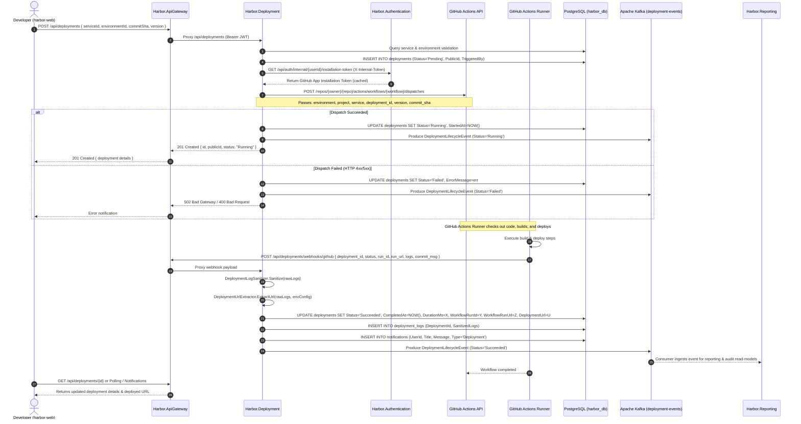
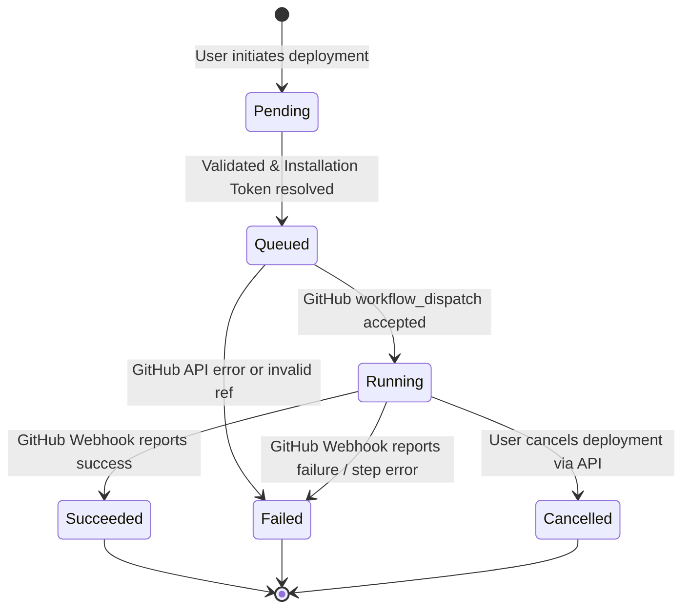

# Harbor Deployment Lifecycle & Automation Flow

This document details the end-to-end deployment lifecycle, state machine transitions, GitHub Actions dispatch mechanics, webhook status reconciliation, and event streaming within the Harbor platform.

---

## 1. Architectural Overview

Harbor decouples deployment **management and visibility** from deployment **execution**:

- **Execution Engine**: GitHub and GitHub Actions. All source code checkout, Docker image building, unit testing, and cloud infrastructure deployments execute on GitHub Actions runners.
- **Control & Visibility Plane**: Harbor. Harbor registers the intent to deploy, verifies permissions, brokers GitHub App credentials, dispatches the workflow, consumes webhook callbacks, scrubs sensitive logs, extracts deployed URLs, streams Kafka lifecycle events, and alerts users.

```text
[Developer / Web UI]
         | (1) POST /api/deployments
         v
[Harbor.ApiGateway]
         |
         v
[Harbor.Deployment]
         | (2) Fetch GitHub App Token
         +----------------------------> [Harbor.Authentication]
         | (3) workflow_dispatch
         +----------------------------> [GitHub Actions API]
         |                                     |
         | (4) Emit 'Started' Event            | (5) Runner Executes Workflow
         +----------------------------> [Kafka]        |
         |                                             v
         | (6) POST /api/deployments/webhooks/github <-+
         v
[Deployment State Reconciled]
   - Status updated (Succeeded/Failed)
   - Logs sanitized via DeploymentLogSanitizer
   - Deployment URL extracted via DeploymentUrlExtractor
   - Notification created in DB
   - Emit 'Completed' Event to Kafka
```

---

## 2. End-to-End Sequence Diagram



---

## 3. GitHub Actions Dispatch Contract

When Harbor triggers a deployment, it invokes the target repository's workflow via:

```http
POST https://api.github.com/repos/{owner}/{repository}/actions/workflows/{workflow-file}/dispatches
Authorization: Bearer {INSTALLATION_TOKEN}
Accept: application/vnd.github.v3+json
Content-Type: application/json

{
  "ref": "main",
  "inputs": {
    "environment": "production",
    "project": "proj-982341",
    "service": "srv-441029",
    "deployment_id": "1042",
    "version": "v1.4.2",
    "commit_sha": "a1b2c3d4e5f67890123456789abcdef01234567"
  }
}
```

### 3.1 Input Parameters Reference
| Parameter | Type | Required | Description |
|:---|:---|:---:|:---|
| `environment` | `string` | **Yes** | Target Harbor environment name (`development`, `staging`, `production`). |
| `project` | `string` | **Yes** | Harbor Project ID or Public ID. |
| `service` | `string` | **Yes** | Harbor Service ID or Public ID. |
| `deployment_id` | `string` | **Yes** | Harbor's internal numeric deployment ID (used for webhook callbacks). |
| `version` | `string` | **Yes** | Semantic version, image tag, or release label. |
| `commit_sha` | `string` | No | Full 40-character Git commit hash (falls back to default branch ref if omitted). |

---

## 4. Webhook Callback & Status Reconciliation

Once GitHub Actions finishes execution (or reaches milestone steps), it posts a callback to Harbor's webhook endpoint:

```http
POST /api/deployments/webhooks/github
Content-Type: application/json

{
  "deployment_id": 1042,
  "status": "succeeded",
  "workflow_run_id": 1827364512,
  "workflow_run_url": "https://github.com/acme/api/actions/runs/1827364512",
  "commit_message": "feat: add payment gateway integration",
  "deployment_url": "https://api.acme.harborapp.tech",
  "logs": "Step 1/5: Building Docker image...\nSuccessfully built image acme-api:v1.4.2\nDeploying to Azure Container Apps...\nDeployment completed at https://api.acme.harborapp.tech"
}
```

### 4.1 Log Sanitization Engine (`DeploymentLogSanitizer`)
Incoming raw logs from CI/CD runners can inadvertently contain sensitive information. Before any log content is persisted to the `deployment_logs` table, `DeploymentLogSanitizer` runs regex scrubbing passes to replace sensitive patterns with `[REDACTED]`:
- GitHub Personal Access Tokens (`ghp_[a-zA-Z0-9]{36}`)
- GitHub App Installation Tokens (`ghs_[a-zA-Z0-9]{36}`)
- Private RSA/OpenSSH Keys (`-----BEGIN (RSA|OPENSSH) PRIVATE KEY-----`)
- AWS Access Keys (`AKIA[0-9A-Z]{16}`)
- Database connection strings (`Password=...`, `pwd=...`)
- Bearer tokens (`Bearer [a-zA-Z0-9._-]+`)

### 4.2 Deployment URL Resolution (`DeploymentUrlExtractor`)
`DeploymentUrlExtractor` determines the final reachable URL of the deployed application through two strategies:
1. **Explicit Webhook Value**: If the workflow callback includes a valid `deployment_url` string, it is parsed and recorded.
2. **Log Pattern Extraction**: If omitted from the payload, regex heuristics scan the sanitized execution output for provider patterns (e.g., `*.azurecontainerapps.io`, `*.onrender.com`, `*.vercel.app`, custom verified domains).

---

## 5. Deployment State Machine



### State Definitions
| State | Description | Next Permitted States |
|:---|:---|:---|
| **`Pending`** | Deployment record created in PostgreSQL. Validating project ownership, environment activation, and resolving credentials. | `Queued`, `Failed` |
| **`Queued`** | GitHub App token resolved; `workflow_dispatch` payload sent to GitHub. | `Running`, `Failed` |
| **`Running`** | GitHub Actions accepted request. The workflow job is running on a GitHub runner. | `Succeeded`, `Failed`, `Cancelled` |
| **`Succeeded`** | Terminal state. Webhook confirmed successful deployment. Final URL extracted. | *None* |
| **`Failed`** | Terminal state. Dispatch rejected, runner step failed, or timeout reached. | *None* |
| **`Cancelled`** | Terminal state. Aborted manually by an authorized user before completion. | *None* |

---

## 6. Notification Dispatch Lifecycle

Harbor features a built-in user notification engine implemented via `NotificationAwareDeploymentRepository`:

1. When a deployment transitions to a terminal state (`Succeeded` or `Failed`), the repository inspects the `TriggeredBy` user ID.
2. An in-app notification entity is created in the `notifications` table containing:
   - `UserId`: ID of the initiating developer.
   - `Title`: "Deployment Succeeded" or "Deployment Failed".
   - `Message`: Summary containing service name, environment name, and duration.
   - `Type`: `Deployment`.
   - `IsRead`: `false`.
   - `CreatedAt`: UTC timestamp.
3. The user's frontend client receives an unread badge on the notification bell (`GET /api/notifications`).
4. The user can mark individual notifications as read (`PATCH /api/notifications/{id}/read`) or dismiss all notifications (`PATCH /api/notifications/read-all`).
