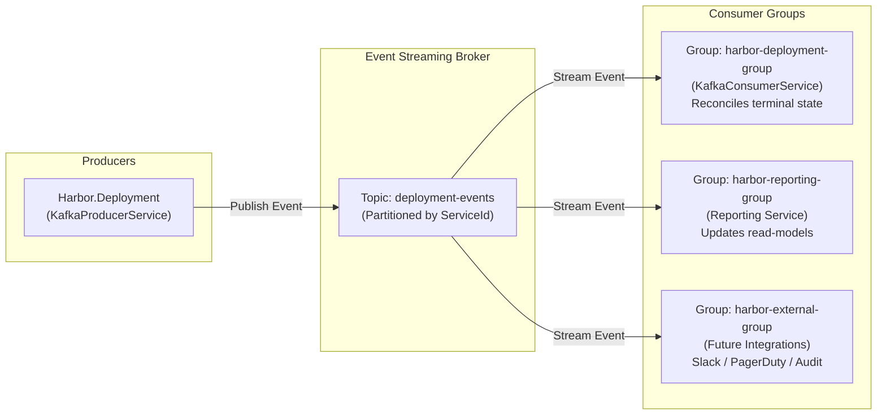

# Harbor Event-Driven Streaming Architecture (Kafka)

This document details Harbor's asynchronous event-driven architecture using **Apache Kafka** (locally) and **Azure Event Hubs** (in production cloud environments).

---

## 1. Architectural Purpose & Decoupling Strategy

In a microservices architecture, synchronous HTTP calls between services can introduce tight coupling, cascading failures, latency accumulation, and fragile deployment sequencing.

Harbor uses **Event-Driven Architecture (EDA)** for critical cross-service notifications and state changes:

- **Producer Autonomy**: When a deployment changes state, `Harbor.Deployment` records the change in its local database and publishes an immutable `DeploymentLifecycleEvent` to Kafka. It does not need to know which downstream services care about this event.
- **Consumer Isolation**: Multiple downstream consumers (e.g., Reporting, Audit, Slack Integrations, Metrics collectors) can subscribe to the same topic independently without imposing load or availability constraints on the deployment engine.
- **Auditability & Replayability**: Events are preserved on the Kafka log according to retention policies, enabling auditing, operational replay, and downstream state reconstruction.



---

## 2. Broker Topology & Protocols

Harbor supports two deployment targets for event streaming through standard Kafka protocol abstraction:

### 2.1 Local Development (Apache Kafka in Docker)
- **Container**: `kafka` service running Apache Kafka (KRaft mode without ZooKeeper).
- **Internal Port**: `kafka:9092` (plaintext, intra-container bridge).
- **Host Port**: `localhost:9092` (development access from host machine).
- **Security Protocol**: `PLAINTEXT`.

### 2.2 Production Azure Environment (Azure Event Hubs)
- **Service**: Azure Event Hubs Standard tier with Kafka 1.0+ compatibility endpoint enabled.
- **Port**: `harbor-eventhub.servicebus.windows.net:9093`.
- **Security Protocol**: `SASL_SSL`.
- **SASL Mechanism**: `PLAIN`.
- **Username**: `$ConnectionString`.
- **Password**: Full Azure Event Hubs shared access key connection string.

---

## 3. Topic Specifications & Partitioning

| Topic Name | Partitions | Partition Key | Retention Period | Compaction |
|:---|:---:|:---|:---:|:---:|
| **`deployment-events`** | 3 | `service_id` | 7 Days | Delete |

### Partitioning Key Strategy
Publishing events with `service_id` as the partition key ensures that all lifecycle events for a specific microservice are routed to the **same partition**. This guarantees strict in-order message delivery per service (e.g., `Queued` is guaranteed to be processed before `Running`, which is guaranteed to be processed before `Succeeded`).

---

## 4. Message Contract: `DeploymentLifecycleEvent`

The event schema is defined in `Harbor.Contracts.Kafka` and shared across producers and consumers:

```json
{
  "eventId": "9b1deb4d-3b7d-4bad-9bdd-2b0d7b3dcb6d",
  "deploymentId": 1042,
  "publicId": "dep-4a8f9c",
  "serviceId": "srv-908123",
  "projectId": "proj-100234",
  "environment": "production",
  "status": "Succeeded",
  "triggeredBy": 14,
  "commitSha": "7f8b3c9a1d2e3f4a5b6c7d8e9f0a1b2c3d4e5f6a",
  "timestamp": "2026-10-16T22:15:30.450Z",
  "durationMs": 145200,
  "workflowRunId": 1827364512,
  "workflowRunUrl": "https://github.com/acme/api/actions/runs/1827364512",
  "deploymentUrl": "https://api.acme.harborapp.tech",
  "errorMessage": null,
  "metadata": {
    "provider": "Azure",
    "region": "centralindia",
    "gitBranch": "main"
  }
}
```

### Schema Field Definitions
| Field | Type | Description |
|:---|:---|:---|
| `eventId` | `UUID` | Unique, idempotency-guaranteed event identifier. |
| `deploymentId` | `int` | Internal numeric deployment ID in PostgreSQL. |
| `publicId` | `string` | Customer-facing alphanumeric identifier (e.g., `dep-4a8f9c`). |
| `serviceId` | `string` | Service identifier owning the deployment. |
| `projectId` | `string` | Project identifier containing the service. |
| `environment` | `string` | Target environment (`development`, `staging`, `production`). |
| `status` | `string` | State transition: `Pending`, `Queued`, `Running`, `Succeeded`, `Failed`, `Cancelled`. |
| `triggeredBy` | `int` | ID of the user who initiated the deployment. |
| `commitSha` | `string` | Git SHA hash executed by CI/CD. |
| `timestamp` | `string` | UTC timestamp of the state transition in ISO-8601 format. |
| `durationMs` | `long?` | Total execution duration in milliseconds (populated for terminal states). |
| `workflowRunUrl` | `string?` | Direct link to the GitHub Actions workflow run execution. |
| `deploymentUrl` | `string?` | Verified live application URL after deployment completion. |
| `errorMessage` | `string?` | Failure reason or timeout message if status is `Failed`. |

---

## 5. Producer Implementation (`KafkaProducerService`)

The producer is registered as a singleton in `Harbor.Deployment`:

```csharp
public class KafkaProducerService : IKafkaProducerService, IDisposable
{
    private readonly IProducer<string, string> _producer;
    private readonly ILogger<KafkaProducerService> _logger;
    private readonly string _topic;

    public KafkaProducerService(IConfiguration config, ILogger<KafkaProducerService> logger)
    {
        var producerConfig = new ProducerConfig
        {
            BootstrapServers = config["KAFKA_BOOTSTRAP_SERVERS"],
            Acks = Acks.Leader,
            MessageTimeoutMs = 5000,
            EnableIdempotence = true
        };
        // Configure SASL if running on Azure Event Hubs
        ConfigureSecurity(producerConfig, config);

        _producer = new ProducerBuilder<string, string>(producerConfig).Build();
        _topic = config["KAFKA_DEPLOYMENT_TOPIC"] ?? "deployment-events";
    }

    public async Task PublishDeploymentLifecycleAsync(DeploymentLifecycleEvent evt)
    {
        try
        {
            var key = evt.ServiceId;
            var json = JsonSerializer.Serialize(evt);
            
            var result = await _producer.ProduceAsync(_topic, new Message<string, string>
            {
                Key = key,
                Value = json
            });
            _logger.LogInformation("Kafka event published to partition {Partition} at offset {Offset}", 
                result.Partition, result.Offset);
        }
        catch (Exception ex)
        {
            // Resilient error logging - Kafka downtime does not break the HTTP transaction
            _logger.LogError(ex, "Failed to publish Kafka event for deployment {DeploymentId}", evt.DeploymentId);
        }
    }
}
```

### Key Producer Design Decisions:
- **Resilience**: The producer wraps calls in comprehensive error handlers. If the Kafka cluster is temporarily unreachable, an error is logged to telemetry, but the core HTTP API transaction succeeds so deployment records are not lost.
- **Idempotence**: `EnableIdempotence = true` avoids message duplication on network retry.

---

## 6. Consumer Implementation (`KafkaConsumerService`)

The consumer runs as a long-running ASP.NET Core `BackgroundService`:

```csharp
public class KafkaConsumerService : BackgroundService
{
    private readonly IConsumer<string, string> _consumer;
    private readonly IServiceScopeFactory _scopeFactory;
    private readonly ILogger<KafkaConsumerService> _logger;

    public KafkaConsumerService(IConfiguration config, IServiceScopeFactory scopeFactory, ILogger<KafkaConsumerService> logger)
    {
        _scopeFactory = scopeFactory;
        _logger = logger;

        var consumerConfig = new ConsumerConfig
        {
            BootstrapServers = config["KAFKA_BOOTSTRAP_SERVERS"],
            GroupId = "harbor-deployment-group",
            AutoOffsetReset = AutoOffsetReset.Earliest,
            EnableAutoCommit = false // Manual commit after successful handling
        };
        ConfigureSecurity(consumerConfig, config);

        _consumer = new ConsumerBuilder<string, string>(consumerConfig).Build();
    }

    protected override async Task ExecuteAsync(CancellationToken stoppingToken)
    {
        _consumer.Subscribe("deployment-events");

        while (!stoppingToken.IsCancellationRequested)
        {
            try
            {
                var consumeResult = _consumer.Consume(stoppingToken);
                if (consumeResult?.Message?.Value != null)
                {
                    var evt = JsonSerializer.Deserialize<DeploymentLifecycleEvent>(consumeResult.Message.Value);
                    await ProcessEventAsync(evt);
                    _consumer.Commit(consumeResult);
                }
            }
            catch (OperationCanceledException) { break; }
            catch (Exception ex)
            {
                _logger.LogError(ex, "Error processing Kafka deployment event");
            }
        }
    }
}
```

### Consumer Group Guarantees
- **At-Least-Once Delivery**: Offsets are committed manually (`EnableAutoCommit = false`) only after `ProcessEventAsync` has completed database synchronization.
- **Poison Pill Defense**: Deserialization exceptions are caught and logged without crashing the background worker loop.
