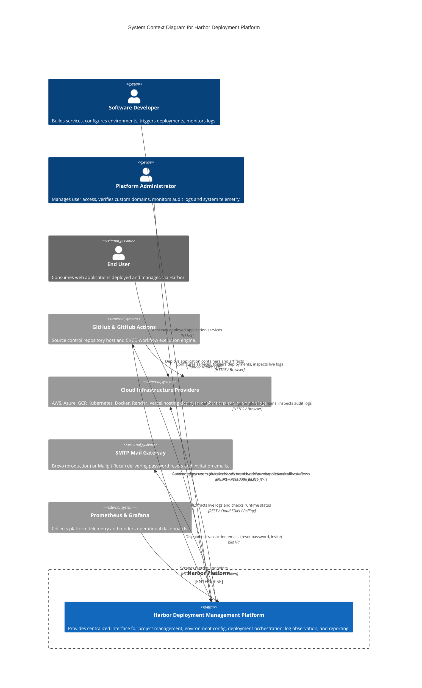

# Harbor System Context & Container Specifications

This document defines the high-level system boundaries, user personas, external dependencies, and container interactions of the **Harbor Platform** using the C4 architectural model.

---

## 1. C4 Level 1: System Context Diagram

The System Context diagram illustrates Harbor's position in the overall ecosystem, the primary user personas who interact with it, and the external third-party systems it depends upon.



---

## 2. Actors & User Personas

Harbor serves two distinct primary personas, plus automated machine interactions:

### 2.1 Software Developer
- **Role & Goals**:
  - Registers new projects and individual microservices.
  - Links services to GitHub repositories.
  - Configures target deployment environments (`Development`, `Staging`, `Production`) and sets environment variables / encrypted secrets.
  - Interactively selects branches or commit SHAs to trigger deployments via GitHub Actions.
  - Streams real-time deployment and application logs directly in the browser.
  - Receives in-app notifications on deployment successes or failures.
- **Entry Point**: `harbor-web` Developer Portal (`http://localhost:5173` or `https://app.harborapp.tech`).

### 2.2 Platform Administrator
- **Role & Goals**:
  - Exercises operational oversight over the entire multi-tenant platform.
  - Manages registered users, modifies roles (`Developer` vs `Admin`), and deactivates accounts.
  - Audits cross-service deployment reports and security audit logs (`AuditLogs`).
  - Oversees global custom domain registrations and triggers automated DNS verification (TXT/CNAME).
  - Inspects system health probes and Prometheus/Grafana dashboards.
- **Entry Point**: `harbor-admin` Admin Portal (`http://localhost:5174` or `https://admin.harborapp.tech`).

### 2.3 Automated CI/CD Runners & Webhooks (Machine Persona)
- **Role & Goals**:
  - GitHub Actions runners executing `workflow_dispatch` jobs.
  - Dispatches automated webhook callbacks back to Harbor (`POST /api/deployments/webhooks/github`) to update deployment statuses, record commit messages, pass execution URLs, and report terminal states.

---

## 3. External System Integrations

| External System | Integration Purpose | Communication Protocol & Auth |
|:---|:---|:---|
| **GitHub App & REST API** | • User authentication via OAuth 2.0<br/>• Browsing repositories, branches, and commit SHAs<br/>• Dispatching `workflow_dispatch` triggers<br/>• Receiving webhook callbacks | HTTPS / REST<br/>• RS256 JWT (App authentication)<br/>• Installation Access Token (scoped to user/org)<br/>• Webhook HMAC signature |
| **Cloud Logging Providers** | Aggregates runtime application logs across heterogeneous hosting environments (AWS CloudWatch, Azure Log Analytics, GCP Logging, Kubernetes, Docker, Render, Vercel, DigitalOcean). | HTTPS / REST / Socket APIs<br/>Provider-specific API tokens & service accounts managed in `ProviderAdapterFactory`. |
| **SMTP Mail Server** | Sends transactional user communications (password reset tokens, account activation, team invitations). | SMTP / TLS<br/>• Local: Mailpit (`localhost:1025`)<br/>• Cloud: Brevo (Sendinblue) over port 587 with API credentials. |
| **Prometheus & Grafana** | Automated scraping of microservice health and custom telemetry metrics (`HarborDeploymentMetrics`). | HTTP `/metrics`<br/>Bearer token authentication via `METRICS_SCRAPE_TOKEN`. |

---

## 4. C4 Level 2: Container Diagram

The Container diagram illustrates the technical architecture within the Harbor boundary, including frontend single-page apps, API Gateway, core microservices, databases, caches, and message brokers.

```mermaid
C4Container
    title Container Diagram for Harbor Platform

    Person(developer, "Developer", "Uses developer portal")
    Person(admin, "Administrator", "Uses admin portal")

    System_Boundary(harbor_container, "Harbor Internal Boundary") {
        Container(web_ui, "harbor-web", "React 19, Vite, Tailwind 4", "Developer SPA: project configuration, environment variables, deployment dashboard, live logs.")
        Container(admin_ui, "harbor-admin", "React 19, Vite, Tailwind 4", "Admin SPA: user management, global custom domains, audit logs, observability.")

        Container(gateway, "Harbor.ApiGateway", "ASP.NET Core, YARP", "Public reverse proxy, rate limiter, CORS manager, router.")

        Container(auth_svc, "Harbor.Authentication", "ASP.NET Core (.NET 10)", "Manages users, password hashing, JWT issuance, OAuth, and token revocation.")
        Container(proj_svc, "Harbor.Project", "ASP.NET Core (.NET 10)", "Manages projects, services, custom domains, and GitHub API proxies.")
        Container(env_svc, "Harbor.Environment", "ASP.NET Core (.NET 10)", "Manages environments, configuration variables, and AES-256-GCM encrypted secrets.")
        Container(deploy_svc, "Harbor.Deployment", "ASP.NET Core (.NET 10)", "Manages deployment lifecycle, GitHub workflow dispatching, webhooks, and notifications.")
        Container(report_svc, "Harbor.Reporting", "ASP.NET Core (.NET 10)", "Aggregates audit logs, deployment reports, and runs SignalR ServiceLogsHub.")

        ContainerDb(database, "Harbor Database", "PostgreSQL 15", "Stores all relational application data in service-isolated schemas.")
        ContainerDb(cache, "Distributed Cache", "Redis 7 / Azure Cache", "Stores cached repository metadata, rate limits, and token revocation blacklist.")
        ContainerDb(broker, "Event Streaming Broker", "Apache Kafka / Azure Event Hubs", "Brokers asynchronous domain events on the deployment-events topic.")
    }

    Rel(developer, web_ui, "Accesses via browser", "HTTPS")
    Rel(admin, admin_ui, "Accesses via browser", "HTTPS")

    Rel(web_ui, gateway, "API requests & WebSocket", "HTTPS / JSON & WSS")
    Rel(admin_ui, gateway, "API requests & WebSocket", "HTTPS / JSON & WSS")

    Rel(gateway, auth_svc, "Proxies /api/auth/*", "HTTP (Internal)")
    Rel(gateway, proj_svc, "Proxies /api/projects/*", "HTTP (Internal)")
    Rel(gateway, env_svc, "Proxies /api/projects/{id}/environments/*", "HTTP (Internal)")
    Rel(gateway, deploy_svc, "Proxies /api/deployments/*, /api/notifications/*", "HTTP (Internal)")
    Rel(gateway, report_svc, "Proxies /api/reporting/*, /hubs/logs/*", "HTTP / WSS (Internal)")

    Rel(auth_svc, database, "Reads/writes users, tokens", "ADO.NET / Npgsql (Port 5432)")
    Rel(auth_svc, cache, "Blacklists revoked tokens", "RESP (Port 6379)")

    Rel(proj_svc, database, "Reads/writes projects, services, domains", "ADO.NET / Npgsql (Port 5432)")
    Rel(proj_svc, cache, "Caches GitHub repository listings", "RESP (Port 6379)")

    Rel(env_svc, database, "Reads/writes envs & encrypted secrets", "ADO.NET / Npgsql (Port 5432)")

    Rel(deploy_svc, database, "Reads/writes deployments, notifications", "ADO.NET / Npgsql (Port 5432)")
    Rel(deploy_svc, broker, "Publishes & consumes deployment-events", "Kafka Protocol (Port 9092 / 9093)")

    Rel(report_svc, database, "Executes cross-service report queries", "ADO.NET / Npgsql (Port 5432)")
    Rel(report_svc, cache, "Buffers real-time log lines", "RESP (Port 6379)")
```



---

## 5. Security Boundaries & Trust Zones

```text
+------------------------------------------------------------------------------------+
| ZONE 1: PUBLIC INTERNET                                                            |
|  - Developer Browser (harbor-web)                                                  |
|  - Administrator Browser (harbor-admin)                                            |
|  - External GitHub Actions Webhook Callbacks                                       |
+------------------------------------------+-----------------------------------------+
                                           | HTTPS (TLS 1.3 / Port 443 / Port 5000)
+------------------------------------------v-----------------------------------------+
| ZONE 2: EDGE INGRESS (DMZ)                                                         |
|  - Harbor.ApiGateway (YARP)                                                        |
|  - Validates TLS, applies CORS policies, runs sliding window rate limiting         |
+------------------------------------------+-----------------------------------------+
                                           | Internal Virtual Network / Container Bridge
+------------------------------------------v-----------------------------------------+
| ZONE 3: INTERNAL MICROSERVICES CLUSTER                                             |
|  - Harbor.Authentication  (:5001)                                                  |
|  - Harbor.Project         (:5002)                                                  |
|  - Harbor.Environment     (:5003)                                                  |
|  - Harbor.Deployment      (:5004)                                                  |
|  - Harbor.Reporting       (:5005)                                                  |
|  * Services communicate inter-service using X-Internal-Token authentication.       |
|  * TokenBlacklistMiddleware inspects Redis for blacklisted JTI claims on all calls.|
+------------------------------------------+-----------------------------------------+
                                           | Internal Data Subnet (No Public Access)
+------------------------------------------v-----------------------------------------+
| ZONE 4: DATA & MESSAGING PERSISTENCE                                               |
|  - PostgreSQL 15 Database (harbor_db)                                              |
|  - Redis 7 Distributed Cache & Revocation Store                                    |
|  - Apache Kafka / Azure Event Hubs Message Broker                                  |
+------------------------------------------------------------------------------------+
```

1. **Zone 1 (Public Internet)**: Untrusted zone. Access is strictly HTTPS.
2. **Zone 2 (Edge Ingress / DMZ)**: Only `Harbor.ApiGateway` exposes an ingress port (`5000` locally, `80/443` on Azure Container Apps). Microservices do not expose public endpoints.
3. **Zone 3 (Internal Microservices Cluster)**: Microservices communicate with each other over internal DNS names (`authentication-service`, `project-service`, etc.). Privileged internal endpoints require an `X-Internal-Token` header.
4. **Zone 4 (Data & Messaging Persistence Tier)**: Relational databases, Redis cache, and Kafka brokers are isolated within the internal virtual network.
