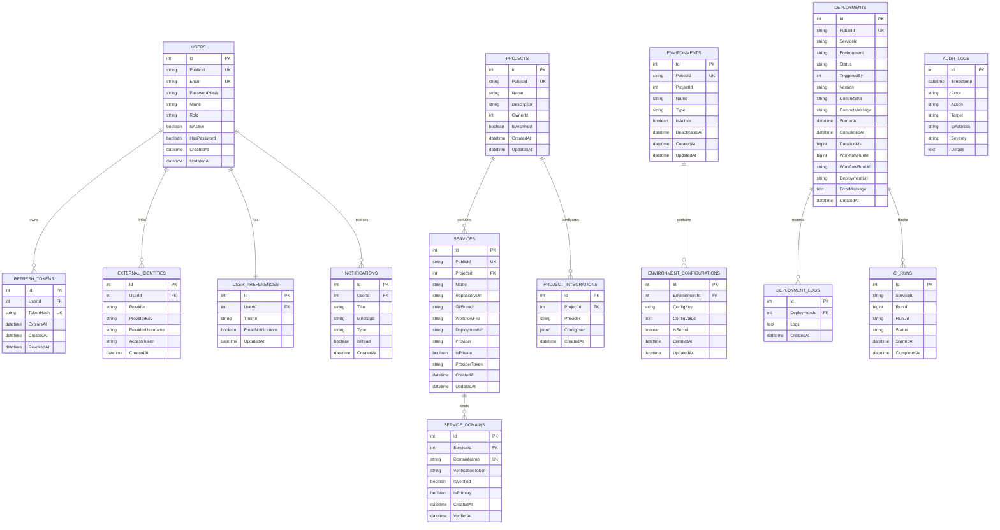

# Harbor Database Architecture & Schema Blueprint

This document details the database architecture, schema definitions, migration pipeline, encryption mechanisms, and ADO.NET data access patterns across the Harbor platform.

---

## 1. Architectural Strategy

Harbor employs a **Shared PostgreSQL Instance with Isolated Service Domains** pattern:

- **Database Engine**: PostgreSQL 15+.
- **Logical Schema Isolation**: All services connect to the same PostgreSQL server (`harbor_db`), but each microservice strictly owns its own set of tables and migrations.
- **Autonomous Data Boundaries**: No service ever performs cross-database joins or queries against another service's private tables. Data access is segregated by bounded context.
- **Cross-Domain Read Models**: The `Harbor.Reporting` service holds read-only querying capability against deployment and project tables to generate consolidated audit reports without duplicating high-volume operational records.
- **Data Access Engine**: Raw SQL via `Npgsql` and ADO.NET behind Repository interfaces. Harbor intentionally avoids Object-Relational Mappers (ORMs) to maintain strict control over SQL generation, avoid unintended N+1 queries, minimize runtime allocations, and guarantee predictable execution plans.

---

## 2. Automated Migration Pipeline (`MigrationRunner`)

Each microservice manages its own schema evolution using an in-app `MigrationRunner`:

```text
src/backend/{ServiceName}/
└── Scripts/
    ├── 0001_CreateInitialTables.sql
    ├── 0002_AddIndexes.sql
    └── 0003_AddPublicIds.sql
```

### Migration Execution Lifecycle
1. On service boot (`Program.cs`), the service invokes `DatabaseInitializer.InitializeAsync()`.
2. The `MigrationRunner` creates a tracking table named `schema_versions` if it does not already exist:
   ```sql
   CREATE TABLE IF NOT EXISTS schema_versions (
       id SERIAL PRIMARY KEY,
       script_name VARCHAR(255) NOT NULL UNIQUE,
       applied_at TIMESTAMPTZ NOT NULL DEFAULT CURRENT_TIMESTAMP
   );
   ```
3. The runner reads all `.sql` files from the embedded `Scripts/` directory, sorts them in lexical/numerical order, and checks if each script has already been applied.
4. Unapplied scripts are executed within an atomic database transaction. If any script fails, the transaction rolls back immediately and aborts service startup to prevent partial schema corruption.

---

## 3. Entity Relationship Diagram (ERD)



---

## 4. Comprehensive Data Dictionary

### 4.1 Harbor.Authentication Tables

#### `Users`
Stores account credentials, profile details, and role assignments.
| Column | Type | Constraints | Description |
|:---|:---|:---|:---|
| `Id` | `SERIAL` | `PRIMARY KEY` | Internal integer surrogate key. |
| `PublicId` | `VARCHAR(32)` | `UNIQUE, NOT NULL` | Customer-facing public ID (e.g. `usr-98a12c`). |
| `Email` | `VARCHAR(255)` | `UNIQUE, NOT NULL` | Login email address. |
| `PasswordHash` | `VARCHAR(255)` | `NULLABLE` | BCrypt password hash (work factor 11). Nullable for pure OAuth accounts. |
| `Name` | `VARCHAR(255)` | `NOT NULL` | User's full name. |
| `Role` | `VARCHAR(50)` | `NOT NULL, DEFAULT 'Developer'` | Security role: `Developer` or `Admin`. |
| `IsActive` | `BOOLEAN` | `NOT NULL, DEFAULT TRUE` | Active status flag. Inactive users are rejected on login. |
| `HasPassword` | `BOOLEAN` | `NOT NULL, DEFAULT TRUE` | Indicates whether local password authentication is configured. |
| `CreatedAt` | `TIMESTAMPTZ` | `NOT NULL, DEFAULT NOW()` | Account creation timestamp. |
| `UpdatedAt` | `TIMESTAMPTZ` | `NOT NULL, DEFAULT NOW()` | Last profile update timestamp. |

#### `RefreshTokens`
Manages long-lived session renewal tokens.
| Column | Type | Constraints | Description |
|:---|:---|:---|:---|
| `Id` | `SERIAL` | `PRIMARY KEY` | Primary key. |
| `UserId` | `INT` | `REFERENCES Users(Id) ON DELETE CASCADE` | Associated user foreign key. |
| `TokenHash` | `VARCHAR(255)` | `UNIQUE, NOT NULL` | SHA-256 hash of the cryptographically secure random token string. |
| `ExpiresAt` | `TIMESTAMPTZ` | `NOT NULL` | Expiration timestamp (default: 30 days). |
| `CreatedAt` | `TIMESTAMPTZ` | `NOT NULL, DEFAULT NOW()` | Token issuance timestamp. |
| `RevokedAt` | `TIMESTAMPTZ` | `NULLABLE` | Revocation timestamp if token was explicitly invalidated. |

#### `ExternalIdentities`
Stores third-party OAuth links (GitHub, Google, etc.).
| Column | Type | Constraints | Description |
|:---|:---|:---|:---|
| `Id` | `SERIAL` | `PRIMARY KEY` | Primary key. |
| `UserId` | `INT` | `REFERENCES Users(Id) ON DELETE CASCADE` | Associated user foreign key. |
| `Provider` | `VARCHAR(50)` | `NOT NULL` | Identity provider name (e.g., `github`). |
| `ProviderKey` | `VARCHAR(255)` | `NOT NULL` | External user ID assigned by the provider. |
| `ProviderUsername` | `VARCHAR(255)` | `NULLABLE` | Provider username (e.g., GitHub handle). |
| `AccessToken` | `TEXT` | `NULLABLE` | Encrypted provider OAuth access token. |
| `CreatedAt` | `TIMESTAMPTZ` | `NOT NULL, DEFAULT NOW()` | Timestamp account was linked. |

---

### 4.2 Harbor.Project Tables

#### `Projects`
Top-level application container.
| Column | Type | Constraints | Description |
|:---|:---|:---|:---|
| `Id` | `SERIAL` | `PRIMARY KEY` | Internal integer identifier. |
| `PublicId` | `VARCHAR(32)` | `UNIQUE, NOT NULL` | Public identifier (e.g., `proj-481b9e`). |
| `Name` | `VARCHAR(255)` | `NOT NULL` | Human-readable project title. |
| `Description` | `TEXT` | `NULLABLE` | Optional project description. |
| `OwnerId` | `INT` | `NOT NULL` | User ID of the project creator. |
| `IsArchived` | `BOOLEAN` | `NOT NULL, DEFAULT FALSE` | Archival flag. Archived projects are read-only. |
| `CreatedAt` | `TIMESTAMPTZ` | `NOT NULL, DEFAULT NOW()` | Timestamp created. |
| `UpdatedAt` | `TIMESTAMPTZ` | `NOT NULL, DEFAULT NOW()` | Timestamp last modified. |

#### `Services`
Microservices configured within projects.
| Column | Type | Constraints | Description |
|:---|:---|:---|:---|
| `Id` | `SERIAL` | `PRIMARY KEY` | Internal integer identifier. |
| `PublicId` | `VARCHAR(32)` | `UNIQUE, NOT NULL` | Public identifier (e.g., `srv-882d1c`). |
| `ProjectId` | `INT` | `REFERENCES Projects(Id) ON DELETE CASCADE` | Parent project foreign key. |
| `Name` | `VARCHAR(255)` | `NOT NULL` | Microservice name. |
| `RepositoryUrl` | `VARCHAR(500)` | `NOT NULL` | Full GitHub repository URL. |
| `GitBranch` | `VARCHAR(255)` | `NOT NULL, DEFAULT 'main'` | Default Git branch to deploy. |
| `WorkflowFile` | `VARCHAR(255)` | `NOT NULL, DEFAULT 'deploy.yml'` | Target GitHub Actions workflow file. |
| `DeploymentUrl` | `VARCHAR(500)` | `NULLABLE` | Default deployed endpoint URL. |
| `Provider` | `VARCHAR(50)` | `NOT NULL, DEFAULT 'Docker'` | Target cloud host: `Azure`, `AWS`, `Docker`, `Render`, `Vercel`, `DigitalOcean`, `Railway`. |
| `IsPrivate` | `BOOLEAN` | `NOT NULL, DEFAULT FALSE` | Indicates whether the repository is private. |
| `ProviderToken` | `TEXT` | `NULLABLE` | Encrypted cloud deployment token if applicable. |
| `CreatedAt` | `TIMESTAMPTZ` | `NOT NULL, DEFAULT NOW()` | Timestamp created. |
| `UpdatedAt` | `TIMESTAMPTZ` | `NOT NULL, DEFAULT NOW()` | Timestamp last updated. |

#### `ServiceDomains`
Custom DNS domain mappings and SSL routing.
| Column | Type | Constraints | Description |
|:---|:---|:---|:---|
| `Id` | `SERIAL` | `PRIMARY KEY` | Primary key. |
| `ServiceId` | `INT` | `REFERENCES Services(Id) ON DELETE CASCADE` | Service foreign key. |
| `DomainName` | `VARCHAR(255)` | `UNIQUE, NOT NULL` | Fully qualified domain name (FQDN). |
| `VerificationToken` | `VARCHAR(64)` | `NOT NULL` | Random token to match in DNS TXT record. |
| `IsVerified` | `BOOLEAN` | `NOT NULL, DEFAULT FALSE` | Domain ownership verification status. |
| `IsPrimary` | `BOOLEAN` | `NOT NULL, DEFAULT FALSE` | Flag indicating primary canonical domain. |
| `CreatedAt` | `TIMESTAMPTZ` | `NOT NULL, DEFAULT NOW()` | Creation timestamp. |
| `VerifiedAt` | `TIMESTAMPTZ` | `NULLABLE` | Timestamp DNS verification succeeded. |

---

### 4.3 Harbor.Environment Tables

#### `Environments`
Deployment target stages for projects.
| Column | Type | Constraints | Description |
|:---|:---|:---|:---|
| `Id` | `SERIAL` | `PRIMARY KEY` | Internal identifier. |
| `PublicId` | `VARCHAR(32)` | `UNIQUE, NOT NULL` | Public identifier (e.g., `env-901a8f`). |
| `ProjectId` | `INT` | `NOT NULL` | Parent project identifier. |
| `Name` | `VARCHAR(100)` | `NOT NULL` | Environment name (e.g. `Staging`). |
| `Type` | `VARCHAR(50)` | `NOT NULL` | Environment category: `Development`, `Staging`, `Production`. |
| `IsActive` | `BOOLEAN` | `NOT NULL, DEFAULT TRUE` | Active status. Inactive environments reject deployments. |
| `DeactivatedAt` | `TIMESTAMPTZ` | `NULLABLE` | Timestamp when environment was deactivated. |
| `CreatedAt` | `TIMESTAMPTZ` | `NOT NULL, DEFAULT NOW()` | Creation timestamp. |
| `UpdatedAt` | `TIMESTAMPTZ` | `NOT NULL, DEFAULT NOW()` | Last update timestamp. |

#### `EnvironmentConfigurations`
Key-value configuration variables and encrypted secrets.
| Column | Type | Constraints | Description |
|:---|:---|:---|:---|
| `Id` | `SERIAL` | `PRIMARY KEY` | Primary key. |
| `EnvironmentId` | `INT` | `REFERENCES Environments(Id) ON DELETE CASCADE` | Environment foreign key. |
| `ConfigKey` | `VARCHAR(255)` | `NOT NULL` | Variable identifier (e.g. `DATABASE_URL`). |
| `ConfigValue` | `TEXT` | `NOT NULL` | Value (plaintext if standard variable; AES-256-GCM ciphertext if secret). |
| `IsSecret` | `BOOLEAN` | `NOT NULL, DEFAULT FALSE` | Indicates whether value is symmetrically encrypted. |
| `CreatedAt` | `TIMESTAMPTZ` | `NOT NULL, DEFAULT NOW()` | Creation timestamp. |
| `UpdatedAt` | `TIMESTAMPTZ` | `NOT NULL, DEFAULT NOW()` | Last updated timestamp. |

---

### 4.4 Harbor.Deployment Tables

#### `Deployments`
The central operational deployment entity.
| Column | Type | Constraints | Description |
|:---|:---|:---|:---|
| `Id` | `SERIAL` | `PRIMARY KEY` | Internal integer ID. |
| `PublicId` | `VARCHAR(32)` | `UNIQUE, NOT NULL` | Public identifier (e.g., `dep-4a8f9c`). |
| `ServiceId` | `VARCHAR(100)` | `NOT NULL` | Target service identifier. |
| `Environment` | `VARCHAR(100)` | `NOT NULL` | Target environment name. |
| `Status` | `VARCHAR(50)` | `NOT NULL` | State: `Pending`, `Queued`, `Running`, `Succeeded`, `Failed`, `Cancelled`. |
| `TriggeredBy` | `INT` | `NOT NULL` | User ID who initiated deployment. |
| `Version` | `VARCHAR(100)` | `NOT NULL` | Release version or semantic label. |
| `CommitSha` | `VARCHAR(100)` | `NOT NULL` | Full 40-character Git commit SHA. |
| `CommitMessage` | `TEXT` | `NULLABLE` | Commit message summary. |
| `StartedAt` | `TIMESTAMPTZ` | `NULLABLE` | Timestamp workflow began execution. |
| `CompletedAt` | `TIMESTAMPTZ` | `NULLABLE` | Timestamp workflow terminated. |
| `DurationMs` | `BIGINT` | `NULLABLE` | Total execution duration in milliseconds. |
| `WorkflowRunId` | `BIGINT` | `NULLABLE` | GitHub Actions workflow run identifier. |
| `WorkflowRunUrl` | `VARCHAR(500)` | `NULLABLE` | URL link to GitHub Actions workflow run page. |
| `DeploymentUrl` | `VARCHAR(500)` | `NULLABLE` | Live application URL extracted from deployment. |
| `ErrorMessage` | `TEXT` | `NULLABLE` | Error diagnostic if deployment failed. |
| `CreatedAt` | `TIMESTAMPTZ` | `NOT NULL, DEFAULT NOW()` | Record creation timestamp. |

#### `DeploymentLogs`
Sanitized build and runtime logs.
| Column | Type | Constraints | Description |
|:---|:---|:---|:---|
| `Id` | `SERIAL` | `PRIMARY KEY` | Primary key. |
| `DeploymentId` | `INT` | `REFERENCES Deployments(Id) ON DELETE CASCADE` | Associated deployment foreign key. |
| `Logs` | `TEXT` | `NOT NULL` | Sanitized log output with secrets redacted. |
| `CreatedAt` | `TIMESTAMPTZ` | `NOT NULL, DEFAULT NOW()` | Log timestamp. |

#### `Notifications`
User notifications for deployment events.
| Column | Type | Constraints | Description |
|:---|:---|:---|:---|
| `Id` | `SERIAL` | `PRIMARY KEY` | Primary key. |
| `UserId` | `INT` | `NOT NULL` | Recipient user ID. |
| `Title` | `VARCHAR(255)` | `NOT NULL` | Notification title (e.g. `Deployment Succeeded`). |
| `Message` | `TEXT` | `NOT NULL` | Summary message details. |
| `Type` | `VARCHAR(50)` | `NOT NULL, DEFAULT 'Deployment'` | Category (`Deployment`, `System`). |
| `IsRead` | `BOOLEAN` | `NOT NULL, DEFAULT FALSE` | Read status. |
| `CreatedAt` | `TIMESTAMPTZ` | `NOT NULL, DEFAULT NOW()` | Timestamp emitted. |

---

### 4.5 Harbor.Reporting Tables

#### `AuditLogs`
Platform security and operational compliance log.
| Column | Type | Constraints | Description |
|:---|:---|:---|:---|
| `Id` | `SERIAL` | `PRIMARY KEY` | Primary key. |
| `Timestamp` | `TIMESTAMPTZ` | `NOT NULL, DEFAULT NOW()` | Event timestamp. |
| `Actor` | `VARCHAR(255)` | `NOT NULL` | User email or service account initiating action. |
| `Action` | `VARCHAR(100)` | `NOT NULL` | Operation performed (`USER_ROLE_CHANGE`, `DOMAIN_VERIFIED`, etc.). |
| `Target` | `VARCHAR(255)` | `NOT NULL` | Target resource identifier. |
| `IpAddress` | `VARCHAR(45)` | `NOT NULL` | Client IP address. |
| `Severity` | `VARCHAR(20)` | `NOT NULL, DEFAULT 'Information'` | Level: `Information`, `Warning`, `Critical`. |
| `Details` | `TEXT` | `NULLABLE` | JSON or structured context. |

---

## 5. Secret Protection at Rest (AES-256-GCM)

Secrets configured in `EnvironmentConfigurations` (`IsSecret = true`) are encrypted using **AES-256-GCM** via `HarborSecretProtector`:

```csharp
public static class HarborSecretProtector
{
    // Encrypts plaintext using AES-256-GCM with a 12-byte random IV and 16-byte authentication tag
    public static string Encrypt(string plainText, byte[] key)
    {
        byte[] iv = new byte[12];
        RandomNumberGenerator.Fill(iv);

        byte[] plainBytes = Encoding.UTF8.GetBytes(plainText);
        byte[] cipherBytes = new byte[plainBytes.Length];
        byte[] tag = new byte[16];

        using var aesGcm = new AesGcm(key, 16);
        aesGcm.Encrypt(iv, plainBytes, cipherBytes, tag);

        // Payload format: Base64( IV [12] + Tag [16] + CipherBytes [N] )
        byte[] payload = new byte[iv.Length + tag.Length + cipherBytes.Length];
        Buffer.BlockCopy(iv, 0, payload, 0, iv.Length);
        Buffer.BlockCopy(tag, 0, payload, iv.Length, tag.Length);
        Buffer.BlockCopy(cipherBytes, 0, payload, iv.Length + tag.Length, cipherBytes.Length);

        return Convert.ToBase64String(payload);
    }
}
```

- **Confidentiality & Authenticity**: If any ciphertext byte in the database is modified, `AesGcm.Decrypt()` throws an `AuthenticationTagMismatchException`, immediately halting execution and detecting tampering.
- **Key Derivation**: The 256-bit symmetric key is derived from the master secret environment variable `ENCRYPTION_KEY`.

---

## 6. ADO.NET Data Access Pattern

Harbor enforces the repository pattern with raw parameterized SQL:

```csharp
public async Task<Deployment?> GetByIdAsync(int id)
{
    await using var connection = _dbConnectionFactory.CreateConnection();
    await connection.OpenAsync();

    const string sql = @"
        SELECT ""Id"", ""PublicId"", ""ServiceId"", ""Environment"", ""Status"", 
               ""TriggeredBy"", ""Version"", ""CommitSha"", ""StartedAt"", ""CompletedAt""
        FROM ""Deployments""
        WHERE ""Id"" = @id
        LIMIT 1;";

    await using var cmd = new NpgsqlCommand(sql, connection);
    cmd.Parameters.AddWithValue("@id", id);

    await using var reader = await cmd.ExecuteReaderAsync();
    if (!await reader.ReadAsync()) return null;

    return new Deployment
    {
        Id = reader.GetInt32(0),
        PublicId = reader.GetString(1),
        ServiceId = reader.GetString(2),
        Environment = reader.GetString(3),
        Status = reader.GetString(4),
        TriggeredBy = reader.GetInt32(5),
        Version = reader.GetString(6),
        CommitSha = reader.GetString(7),
        StartedAt = reader.IsDBNull(8) ? null : reader.GetDateTime(8),
        CompletedAt = reader.IsDBNull(9) ? null : reader.GetDateTime(9)
    };
}
```

### Advantages of this Architecture:
1. **Zero SQL Injection Risk**: All parameters are bound through `NpgsqlParameter` objects — string concatenation of user inputs is strictly prohibited.
2. **Explicit Connection Lifetime**: `await using` guarantees that connection objects are returned immediately to the Npgsql pool upon scope exit.
3. **No Migration Lock-In**: Database migrations are clean, versioned SQL statements readable and testable by any database engineer.
