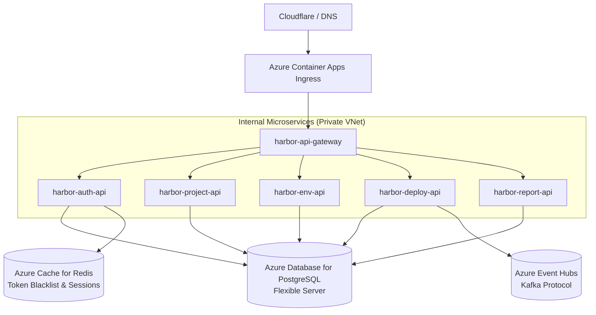

# Harbor Deployment & Operations Guide

This guide provides instructions for deploying, configuring, and operating the Harbor platform across local development environments and cloud production environments (Azure Container Apps).

---

## 1. System Requirements & Prerequisites

### 1.1 Local Development
| Requirement | Recommended Version | Purpose |
|:---|:---|:---|
| **Operating System** | Linux (Ubuntu 22.04+ / Debian 12), macOS, or Windows 11 with WSL2 | Host platform |
| **.NET SDK** | .NET 10 SDK (minimum: .NET 8 SDK) | Backend service compilation & execution |
| **Node.js & npm** | Node.js 20+ (LTS) / npm 10+ | Frontend Single-Page App development |
| **Docker Engine & Compose** | Docker 24+ with Docker Compose v2+ | Container orchestration |
| **Git** | 2.40+ | Version control |

### 1.2 Production Cloud (Azure)
- **Azure Subscription** with permissions to provision:
  - Azure Container Apps (ACA) & Container Apps Environment
  - Azure Container Registry (ACR)
  - Azure Database for PostgreSQL Flexible Server
  - Azure Cache for Redis
  - Azure Event Hubs (with Kafka 1.0+ protocol support)
- **Azure CLI** (`az`) installed and authenticated (`az login`).

---

## 2. Configuration & Environment Variables Reference

Harbor reads its configuration from environment variables or a root `.env` file loaded via `DotNetEnv`.

Create your local `.env` file from `.env.example`:
```bash
cp .env.example .env
```

### 2.1 Configuration Key Catalog

#### Database (PostgreSQL)
| Variable | Default (Local) | Azure Production | Description |
|:---|:---|:---|:---|
| `POSTGRES_SERVER` | `localhost` (or `postgres` in Docker) | `harbor-psql.postgres.database.azure.com` | PostgreSQL host address |
| `POSTGRES_PORT` | `5432` | `5432` | PostgreSQL network port |
| `POSTGRES_DATABASE` | `harbor_db` | `harbor_db` | Application database name |
| `POSTGRES_USER` | `harbor_user` | `harbor_admin` | Database username |
| `POSTGRES_PASSWORD` | `harbor_password` | *(Secured via Key Vault)* | Database password |
| `POSTGRES_SSL_MODE` | `Disable` (or `Prefer`) | `Require` | SSL encryption enforcement |

#### Distributed Caching (Redis)
| Variable | Default (Local) | Azure Production | Description |
|:---|:---|:---|:---|
| `REDIS_CONNECTION_STRING` | `localhost:6379` (or `redis:6379`) | `harbor-cache.redis.cache.windows.net:6380,ssl=True,abortConnect=False` | StackExchange.Redis connection string |
| `REDIS_PASSWORD` | *(Empty)* | *(Azure primary access key)* | Redis authentication password |

#### Event Streaming (Kafka / Azure Event Hubs)
| Variable | Default (Local) | Azure Production | Description |
|:---|:---|:---|:---|
| `KAFKA_BOOTSTRAP_SERVERS` | `localhost:9092` (or `kafka:9092`) | `harbor-eventhub.servicebus.windows.net:9093` | Kafka broker bootstrap servers |
| `KAFKA_DEPLOYMENT_TOPIC` | `deployment-events` | `deployment-events` | Target event streaming topic |
| `KAFKA_SECURITY_PROTOCOL` | `PLAINTEXT` | `SASL_SSL` | Connection security protocol |
| `KAFKA_SASL_MECHANISM` | *(None)* | `PLAIN` | SASL authentication mechanism |
| `KAFKA_SASL_USERNAME` | *(None)* | `$ConnectionString` | Event Hubs SASL username |
| `KAFKA_SASL_PASSWORD` | *(None)* | *(Event Hubs Shared Access Key)* | Event Hubs connection string |

#### Identity, Cryptography & Security
| Variable | Format / Length | Description |
|:---|:---|:---|
| `JWT_SECRET` | String (Min 32 chars) | HMAC-SHA256 signature key for signing and verifying access tokens |
| `JWT_ISSUER` | String (`Harbor.Authentication`) | Expected `iss` claim in JWT payloads |
| `JWT_AUDIENCE` | String (`Harbor.Clients`) | Expected `aud` claim in JWT payloads |
| `JWT_EXPIRATION_MINUTES` | Integer (e.g., `60`) | Access token validity duration |
| `ENCRYPTION_KEY` | 32-byte Base64 String | Master key for AES-256-GCM symmetric encryption of environment secrets |
| `INTERNAL_API_KEY` | High-entropy string | Shared secret for `X-Internal-Token` header on inter-service endpoints |
| `METRICS_SCRAPE_TOKEN` | High-entropy string | Bearer token required to scrape `/metrics` endpoints in production |

#### GitHub App & Actions Integration
| Variable | Description |
|:---|:---|
| `GITHUB_APP_ID` | Numeric App ID assigned when registering the GitHub App |
| `GITHUB_CLIENT_ID` | OAuth Client ID for developer login flows |
| `GITHUB_CLIENT_SECRET` | OAuth Client Secret for code exchange |
| `GITHUB_PRIVATE_KEY_PATH` | Path to the downloaded GitHub App `.pem` private key file |
| `GITHUB_WEBHOOK_SECRET` | Secret used to verify HMAC signatures of GitHub webhook callbacks |

#### Transactional Email (SMTP)
| Variable | Local Default | Production Default | Description |
|:---|:---|:---|:---|
| `SMTP_HOST` | `localhost` (or `mailpit`) | `smtp-relay.brevo.com` | SMTP gateway host |
| `SMTP_PORT` | `1025` | `587` | SMTP port |
| `SMTP_USER` | *(Empty)* | *(Brevo login)* | SMTP username |
| `SMTP_PASS` | *(Empty)* | *(Brevo API key)* | SMTP password |
| `SMTP_FROM` | `no-reply@harbor.local` | `no-reply@harborapp.tech` | Sender address |

---

## 3. Local Development Workflows

Harbor supports two local development workflows:

### 3.1 Option A: Complete Docker Compose Stack
Runs all microservices, frontends, databases, caches, and brokers in containers:

```bash
# Build and run all services in background
docker compose -f docker-compose.yml -f docker-compose.dev.yml up --build -d

# Follow aggregate logs
docker compose logs -f

# Verify running containers
docker compose ps
```

#### Local Port Bindings
- **Harbor Web (Developer UI)**: `http://localhost:5173`
- **Harbor Admin (Admin UI)**: `http://localhost:5174`
- **Harbor API Gateway**: `http://localhost:5000`
- **Mailpit Web UI (Local Emails)**: `http://localhost:8025`
- **Kafka Broker**: `localhost:9092`
- **PostgreSQL Database**: `localhost:5432`
- **Redis Cache**: `localhost:6379`
- **Prometheus UI**: `http://localhost:9090`
- **Grafana UI**: `http://localhost:3000` (credentials: `admin` / `admin`)

---

### 3.2 Option B: Hybrid Development (Recommended for Active Development)
Runs backing stores in Docker while running backend services and frontend apps on bare metal for fast incremental compilation and hot-reloading:

#### Step 1: Start Backing Services
```bash
docker compose up -d postgres redis kafka mailpit
```

#### Step 2: Run Backend Services
In separate terminal tabs, launch the ASP.NET Core projects:
```bash
# 1. API Gateway
dotnet run --project src/backend/Harbor.ApiGateway --urls="http://localhost:5000"

# 2. Authentication Service
dotnet run --project src/backend/Harbor.Authentication --urls="http://localhost:5001"

# 3. Project Service
dotnet run --project src/backend/Harbor.Project --urls="http://localhost:5002"

# 4. Environment Service
dotnet run --project src/backend/Harbor.Environment --urls="http://localhost:5003"

# 5. Deployment Service
dotnet run --project src/backend/Harbor.Deployment --urls="http://localhost:5004"

# 6. Reporting Service
dotnet run --project src/backend/Harbor.Reporting --urls="http://localhost:5005"
```

#### Step 3: Run Frontend Applications
In a new terminal:
```bash
cd src/frontend
npm install
npm run dev
```

---

## 4. Production Deployment on Azure (Azure Container Apps)

Harbor is optimized for deployment to **Azure Container Apps (ACA)** within an isolated Container Apps Environment:



### 4.1 Azure Container Registry Build & Push
Images are packaged using multi-stage production Dockerfiles:

```bash
ACR_NAME="harboracr"

# Log in to Azure Container Registry
az acr login --name "$ACR_NAME"

# Build and push images
docker build -t $ACR_NAME.azurecr.io/harbor-api-gateway:latest -f src/backend/Harbor.ApiGateway/Dockerfile .
docker build -t $ACR_NAME.azurecr.io/harbor-auth-api:latest -f src/backend/Harbor.Authentication/Dockerfile .
docker build -t $ACR_NAME.azurecr.io/harbor-project-api:latest -f src/backend/Harbor.Project/Dockerfile .
docker build -t $ACR_NAME.azurecr.io/harbor-env-api:latest -f src/backend/Harbor.Environment/Dockerfile .
docker build -t $ACR_NAME.azurecr.io/harbor-deploy-api:latest -f src/backend/Harbor.Deployment/Dockerfile .
docker build -t $ACR_NAME.azurecr.io/harbor-report-api:latest -f src/backend/Harbor.Reporting/Dockerfile .
docker build -t $ACR_NAME.azurecr.io/harbor-web-ui:latest -f src/frontend/harbor-web/Dockerfile src/frontend/harbor-web
docker build -t $ACR_NAME.azurecr.io/harbor-admin-ui:latest -f src/frontend/harbor-admin/Dockerfile src/frontend/harbor-admin

# Push images to ACR
for img in gateway auth-api project-api env-api deploy-api report-api web-ui admin-ui; do
  docker push $ACR_NAME.azurecr.io/harbor-$img:latest
done
```

### 4.2 Scaling & Operational Control
To control Azure cloud computing costs when demoing or performing maintenance, use the scaling scripts detailed in [`docs/system_status.md`](../system_status.md):

- **Scale to Zero (Stop)**: Scales all container app replicas to 0 when idle.
- **Sequential Restart**: Scales Redis -> Backend APIs -> API Gateway -> Frontends with healthy readiness probe confirmation.

---

## 5. Health Verification & Telemetry Inspection

After starting Harbor, verify system health using the probe endpoints:

### 5.1 Verification Script
```bash
# Gateway Health
curl -s http://localhost:5000/health | jq .

# Authentication Service Liveness & Readiness
curl -s http://localhost:5001/health/live | jq .
curl -s http://localhost:5001/health/ready | jq .

# Deployment Service Readiness (verifies DB & Kafka)
curl -s http://localhost:5004/health/ready | jq .
```

### 5.2 Expected Readiness Probe Response
```json
{
  "status": "Healthy",
  "totalDuration": "00:00:00.0034201",
  "entries": {
    "self": {
      "status": "Healthy",
      "description": "Harbor.Deployment is running"
    },
    "database": {
      "status": "Healthy",
      "description": "Database connection verified"
    },
    "redis": {
      "status": "Healthy",
      "description": "Redis cache is accessible"
    }
  }
}
```

---

## 6. Common Troubleshooting Procedures

### 6.1 Database Connection Refused (`Npgsql.NpgsqlException`)
- **Symptom**: Services fail to boot with connection refused to port 5432.
- **Cause**: PostgreSQL container is still initializing or port is occupied by a host PostgreSQL server.
- **Fix**: Check `docker compose ps` to verify PostgreSQL is running. Test connectivity with `pg_isready -h localhost -p 5432`.

### 6.2 Redis Connection Timeout
- **Symptom**: `RedisConnectionException: It was not possible to connect to the redis server`.
- **Cause**: Incorrect `REDIS_CONNECTION_STRING` or host port conflict.
- **Fix**: Verify Redis is active with `redis-cli ping` (should respond `PONG`). Ensure password is provided if configured.

### 6.3 CORS Errors in Frontend Console
- **Symptom**: `Access to fetch has been blocked by CORS policy: No 'Access-Control-Allow-Origin' header is present`.
- **Cause**: Request origin is missing from `ALLOWED_ORIGINS` in `.env`.
- **Fix**: Update `ALLOWED_ORIGINS` in `.env` to include your exact frontend URL (e.g. `http://localhost:5173,http://localhost:5174`) and restart `Harbor.ApiGateway`.

### 6.4 GitHub App Authentication Failure (`HttpError: 401 Bad credentials`)
- **Symptom**: Deployment dispatches fail when calling GitHub API.
- **Cause**: Private key path is invalid or system clock drift.
- **Fix**: Verify `GITHUB_PRIVATE_KEY_PATH` exists and is readable. Check server time synchronization via `timedatectl`.
