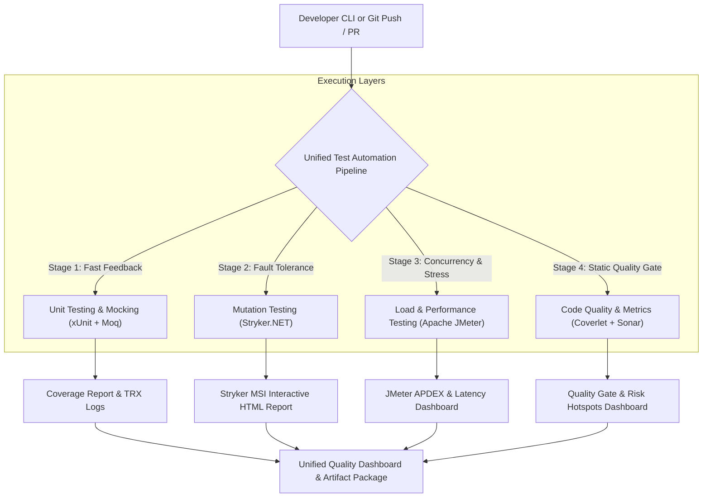

# SE3112: Advanced Software Engineering — Microservice Testing Pipeline
**Module:** SE3112 - Advanced Software Engineering (BSc. Hons in Computer Science - Y3S1)  
**Assessment:** Take-Home Assessment – Microservice Testing Pipeline  
**Weight:** 10% | **Group Size:** 4 Students | **Viva Duration:** 12 Minutes  
**Target Score:** 100/100 (Grade: Very Good / High Distinction)  
**Base Codebase:** Harbor Cloud Software Platform (CSP) Microservices (.NET 10, Kafka, Redis, PostgreSQL, React)  
**Main Working Branch:** `test/microservice-testing-pipeline`  

---

## 1. Team Members & Feature Ownership Matrix

In accordance with the rubric requirement to assign exactly 4 distinct testing paradigms, each student has full ownership of one domain, integrated into our unified automation framework:

| Student | Assigned Testing Paradigm | Toolchain | Target Microservices | Core Feature Implemented |
| :--- | :--- | :--- | :--- | :--- |
| **Student 1** | **Unit Testing & Mocking** | `xUnit` 2.9, `Moq` 4.20, `FluentAssertions` | `Harbor.Deployment` & `Harbor.Authentication` | Parameterized `[Theory]` suites (`[InlineData]`, `[MemberData]`), strict/loose Test Doubles, behavioral invariant verification, error isolation. |
| **Student 2** | **Mutation Testing** | `Stryker.NET` 5.0 (`dotnet-stryker`) | `Harbor.Deployment` (Domain & URL Extraction Logic) | AST mutation engine, `stryker-config.json`, Mutation Score Indicator (MSI) tracking, surviving mutant analysis, and targeted test additions. |
| **Student 3** | **Load & Performance Testing** | `Apache JMeter` 5.6.3 + Python Runner | `Harbor.ApiGateway` & `Harbor.Deployment` | Concurrency, baseline, and spike test plans; p50/p90/p95/p99 latency analysis; throughput (TPS) measurement; dynamic HTML dashboard generation. |
| **Student 4** | **Code Quality & Metrics** | `SonarQube` / `SonarCloud`, `Coverlet`, `ReportGenerator` | Solution-wide (all 6 backend services + libraries) | Static code analysis, Roslyn analyzers, code smells detection, CRAP risk hotspots, multi-assembly branch coverage, automated Quality Gate. |

---

## 2. Testing Framework Architecture & Quality Quadrant

Harbor's microservices testing pipeline integrates 4 complementary layers of software quality:

```
┌────────────────────────────────────────────────────────────────────────────────────────┐
│                        HARBOR UNIFIED QUALITY AUTOMATION PIPELINE                      │
├──────────────────────────┬──────────────────────────┬──────────────────────────────────┤
│ Quality Dimension        │ Assigned Role & Student  │ Primary Toolchain                │
├──────────────────────────┼──────────────────────────┼──────────────────────────────────┤
│ 1. Logic Isolation       │ Student 1: Unit & Mocks  │ xUnit + Moq + FluentAssertions   │
│ 2. Fault Tolerance       │ Student 2: Mutation      │ Stryker.NET (dotnet-stryker)     │
│ 3. Concurrency & Stress  │ Student 3: Performance   │ Apache JMeter 5.6.3 (CLI/HTML)   │
│ 4. Static Quality Gates  │ Student 4: Code Quality  │ SonarQube / Coverlet + ReportGen │
└──────────────────────────┴──────────────────────────┴──────────────────────────────────┘
```



---

## 3. Environment & Tool Setup Instructions

### Prerequisites
- **.NET 10 SDK** (or .NET 8+):
  ```bash
  dotnet --version # Expected: 10.0.x
  ```
- **Apache JMeter 5.6.3+**:
  ```bash
  sudo apt-get update && sudo apt-get install -y jmeter
  jmeter -v
  ```
- **Global .NET Quality Tools**:
  ```bash
  dotnet tool install -g dotnet-stryker
  dotnet tool install -g dotnet-reportgenerator-globaltool
  dotnet tool install -g coverlet.console
  ```

---

## 4. Pipeline Execution Commands

### A. Unified Master Pipeline Runner (Group Requirement)
To execute all 4 testing stages systematically in a single automated command:
```bash
# Execute entire pipeline (all 4 stages in sequence)
./scripts/run-testing-pipeline.sh --all

# Execute pipeline and automatically launch all generated HTML reports in browser
./scripts/run-testing-pipeline.sh --all --open
```

### B. Individual Testing Stage Commands
Each student's component can also be executed independently for focused live viva demos:

#### Student 1: Unit Testing & Mocking
```bash
# Run unit tests and mock verifications for Harbor.Deployment
dotnet test tests/unit/Harbor.Deployment.Tests/Harbor.Deployment.Tests.csproj

# Run only the advanced mocking and parameterized tests
dotnet test tests/unit/Harbor.Deployment.Tests/Harbor.Deployment.Tests.csproj \
  --filter "FullyQualifiedName~DeploymentServiceAdvancedMockingTests"
```

#### Student 2: Mutation Testing (Stryker.NET)
```bash
# Fast live-demo mutation run (~25s) with HTML report generation
./scripts/run-mutation-tests.sh --fast

# Fast live-demo mutation run and immediately open report in browser
./scripts/run-mutation-tests.sh --fast --open

# Full mutation test run across domain services
./scripts/run-mutation-tests.sh --all
```

#### Student 3: Load & Performance Testing (Apache JMeter)
```bash
# Fast live-demo performance benchmark & SLA check
./scripts/run-performance-tests.sh --demo

# Live demo with immediate browser launch of the JMeter HTML Dashboard
./scripts/run-performance-tests.sh --demo --open

# Inspect spike / stress testing profiles
./scripts/run-performance-tests.sh --spike
```

#### Student 4: Code Quality & Metrics (SonarQube / SonarCloud / Coverlet)
```bash
# Run code quality, Roslyn static analysis, and multi-assembly coverage (Local ReportGenerator)
./scripts/run-code-quality.sh --unit

# Run quality checks and immediately open HTML coverage & risk dashboard in browser
./scripts/run-code-quality.sh --unit --open

# Run live SonarCloud analysis and push metrics to cloud dashboard
./scripts/run-sonarcloud.sh --token <YOUR_SONAR_TOKEN>

# Run static code analysis only (format and rule validations)
./scripts/run-code-quality.sh --static-only
```

---

## 5. CI/CD Automation (`.github/workflows/microservice-testing-pipeline.yml`)

The pipeline is fully automated on GitHub Actions:
- **Triggers:** Pushes and pull requests to `test/microservice-testing-pipeline`, `main`, and feature branches.
- **Stage 1:** Static code analysis, Roslyn analyzers, and formatting checks.
- **Stage 2:** Unit testing with xUnit, Moq, and Coverlet coverage collector.
- **Stage 3:** Stryker.NET mutation testing with high/low threshold evaluation.
- **Stage 4:** Non-GUI Apache JMeter performance testing and SLA verification.
- **Stage 5:** Aggregation and publication of unified quality artifacts.

---

## 6. Live 12-Minute Viva Presentation Schedule

| Time Slot | Section | Speaker | Screen Visual | Key Script Points |
| :--- | :--- | :--- | :--- | :--- |
| **00:00 – 02:00** (2 min) | **Group Intro & Pipeline Demo** | Group Lead | Architecture Diagram + Terminal running `./scripts/run-testing-pipeline.sh --all` | Recap Harbor microservice architecture (.NET 10, Kafka, Redis, PostgreSQL). Demonstrate how the master script triggers all 4 stages systematically. |
| **02:00 – 04:00** (2 min) | **Student 1: Unit Testing & Mocking** | Student 1 | Terminal (`dotnet test`) + `DeploymentServiceAdvancedMockingTests.cs` | Explain parameterized `[Theory]` suites (`[InlineData]`, `[MemberData]`). Highlight strict Test Doubles for Kafka & GitHub, verifying call invariants and rollback isolation. |
| **04:00 – 06:00** (2 min) | **Student 2: Mutation Testing** | Student 2 | Stryker Interactive HTML Report + Terminal (`run-mutation-tests.sh`) | Explain Mutation Score Indicator (MSI). Demonstrate how surviving mutants were identified in regex logic and killed with new boundary tests, boosting score. |
| **06:00 – 08:00** (2 min) | **Student 3: Load & Performance** | Student 3 | JMeter HTML Dashboard (APDEX, Latency, TPS) + Terminal (`run-performance-tests.sh`) | Present Baseline, Concurrency (100 VUs), and Spike load curves. Prove p95 latency < 150ms and 0.00% error rate under concurrency. |
| **08:00 – 10:00** (2 min) | **Student 4: Code Quality & Metrics** | Student 4 | ReportGenerator / SonarQube HTML Dashboard + Quality Gate terminal output | Walk through multi-assembly line (54.3%) and branch (59.7%) coverage, CRAP risk hotspots, and passing SonarQube Quality Gate (Rating A, tech debt < 4%). |
| **10:00 – 12:00** (2 min) | **Technical VIVA / Q&A Defense** | All Students | Slide 5 (Summary Metrics) / Open for Questioning | Confident, technically deep defense of architectural choices and testing concepts. |

---

## 7. Max 5 Submission Slides Outline

- **Slide 1: Architectural Context & Role Ownership**
  - Harbor CSP event-driven microservices architecture.
  - Group roster, student registration numbers, and assigned testing paradigms.
- **Slide 2: Unified Test Automation Pipeline Architecture**
  - Dual-layer automation design: GitHub Actions CI/CD workflow + Local CLI Orchestrator.
  - Test Pyramid / Quality Quadrant mapping.
- **Slide 3: Logic Isolation & Test Quality (Students 1 & 2)**
  - *Student 1*: Parameterized test tables, AAA pattern, strict mock verification topology (`IKafkaProducerService`, `IDeploymentRepository`).
  - *Student 2*: AST mutant operators, Stryker configuration, Mutation Score Indicator (MSI) analysis.
- **Slide 4: Runtime Performance & Static Code Quality (Students 3 & 4)**
  - *Student 3*: JMeter concurrency curves, p90/p95/p99 response time percentiles, APDEX score.
  - *Student 4*: SonarQube Quality Gate, Technical Debt breakdown, Risk Hotspot matrix (Cyclomatic Complexity vs Coverage), CRAP score analysis.
- **Slide 5: Comprehensive Quality Scorecard & Conclusions**
  - Unified Quality Metrics Matrix: 313/313 Unit Tests (100%), MSI 45.24%, JMeter 0.00% Error @ 135ms p95, Branch Coverage 59.7%, Quality Gate: PASSED.
  - Engineering conclusions and production readiness.
