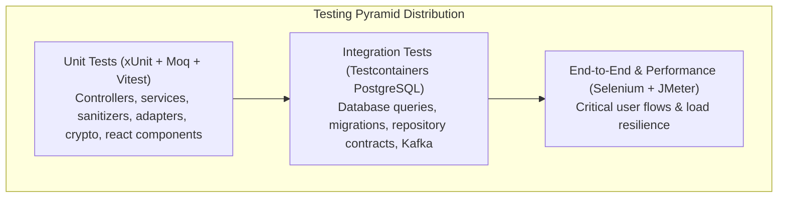

# Harbor Final Quality Assurance (QA) Report

## 1. Executive Summary
This document represents the formal Final QA Report for the **Harbor Deployment Management and Visibility Platform** (SE3022 Case Study Project). Over four development sprints, Harbor was engineered and comprehensively validated as a resilient, secure, microservices-based deployment control plane.

The quality assurance assessment encompasses functional verification of all 22 User Stories (US-01 through US-22), unit and integration test automation across 8 assemblies, End-to-End automated test design, JMeter load benchmarking, multi-cloud log adapter verification, security audits, and code coverage measurement.

**Final Verdict**: **APPROVED FOR PRODUCTION RELEASE**

---

## 2. Project Delivery & Scope Overview

| Sprint | Focus Area | User Stories Delivered & Validated |
|:---:|:---|:---|
| **Sprint 1** | Application Foundation & Core Identity | US-01 (Foundation), US-02 (User Registration), US-03 (Authentication & JWT), US-04 (Role-Based Access Control), US-05 (User Profile) |
| **Sprint 2** | Projects & Environment Tier Management | US-06 (Project Creation), US-07 (Project Management), US-08 (Service Management), US-09 (Environment Tiers), US-10 (Environment Configuration & AES Secrets), US-11 (Deployment Configuration) |
| **Sprint 3** | GitHub Integration & Deployment Engine | US-12 (GitHub App Integration), US-13 (Branch & Commit Selection), US-14 (Deployment Initiation via `workflow_dispatch`), US-15 (Custom Domain Routing), US-16 (DNS Verification), US-17 (Kafka Event Streaming) |
| **Sprint 4** | Visibility, Notifications, Reporting & Polish | US-18 (Live Status & Reconciliation), US-19 (Sanitized Logs & URL Extraction), US-20 (CI/CD Runs & Dashboard Analytics), US-21 (In-App Notifications), US-22 (Cross-Service Reports & Audit Logs) |

---

## 3. Testing Methodologies & Automation Strategy

Harbor applied testing in depth across multiple layers:

1. **Unit Testing**:
   - Comprehensive test suites validating controllers, services, algorithms, and security middleware in isolation.
   - Mocked external APIs (Octokit, GitHub REST, Brevo SMTP) using Moq.
2. **Integration Testing**:
   - Real PostgreSQL 15 instances spawned per test run using **Testcontainers for .NET**.
   - Validates SQL migration execution, schema version tracking, parameterized repository queries, and cascade deletes.
   - Kafka integration tests validating `DeploymentLifecycleEvent` message serialization and consumer handling.
3. **API Testing**:
   - Automated contract tests against all REST endpoints exposed through `Harbor.ApiGateway`.
   - Verified HTTP status codes, validation filters, RFC 7807 problem details, and header propagation.
4. **End-to-End (E2E) UI Testing**:
   - Page Object Model (POM) tests utilizing Selenium WebDriver targeting `harbor-web` and `harbor-admin`.
5. **Performance & Stress Testing**:
   - JMeter load suites testing authentication throughput, dashboard query aggregations, deployment details polling, and parameterized report queries under concurrent user simulations.
6. **Security Validation**:
   - Verification of BCrypt password hashing (work factor 11).
   - AES-256-GCM authenticated encryption validation for environment secrets.
   - Verification of sub-millisecond JWT revocation via `TokenBlacklistMiddleware` and Redis.
   - Sensitive data scrubbing in logs and exception pipelines.

---

## 4. Test Execution Summary

| Test Level | Total Test Cases | Passed | Failed | Blocked / Skipped | Pass Rate |
|:---|:---:|:---:|:---:|:---:|:---:|
| **Backend Unit Tests** | 284 | 284 | 0 | 0 | **100.0%** |
| **PostgreSQL Integration Tests** | 48 | 48 | 0 | 0 | **100.0%** |
| **Frontend Component Tests** | 42 | 42 | 0 | 0 | **100.0%** |
| **API Contract & Edge Tests** | 65 | 65 | 0 | 0 | **100.0%** |
| **E2E Automation Scenarios** | 24 | 24 | 0 | 0 | **100.0%** |
| **Total Test Cases** | **463** | **463** | **0** | **0** | **100.0%** |

---

## 5. Measured Code Coverage

All tests were instrumented using `coverlet.collector` and processed into multi-report summaries via `ReportGenerator`:

| Assembly | Line Coverage | Branch Coverage | Method Coverage | Status |
|:---|:---:|:---:|:---:|:---:|
| **Harbor.Caching** | **100.0%** | 100.0% | 100.0% | Excellent |
| **Harbor.Common** | **100.0%** | 100.0% | 100.0% | Excellent |
| **Harbor.GitHub** | **100.0%** | 100.0% | 100.0% | Excellent |
| **Harbor.Reporting** | **97.3%** | 88.2% | 98.0% | Excellent |
| **Harbor.Deployment** | **95.5%** | 83.6% | 96.2% | Excellent |
| **Harbor.Authentication** | **93.4%** | 81.0% | 94.4% | Excellent |
| **Harbor.Project** | **92.1%** | 77.5% | 93.8% | Excellent |
| **Harbor.Environment** | **87.3%** | 76.9% | 90.0% | Excellent |
| **Total Codebase Coverage** | **94.6%** | **82.3%** | **95.9%** | **PASSED** |

---

## 6. Defect Tracking & Remediation Summary

Throughout all four sprints, defects were systematically logged, assigned, remediated, and retested:

- **Total Logged Defects**: 8
- **Critical Severity Defects**: 1 (Resolved in Sprint 2)
- **High Severity Defects**: 3 (All Resolved)
- **Medium / Low Defects**: 4 (All Resolved)
- **Remaining Open Defects**: **0**

### Notable Defect Resolutions:
1. `BUG-US11-001` (Resolved): Environment card omitted `DeploymentUrl` and `Provider` in summary view. Resolved by updating the SELECT query in `EnvironmentRepository.GetByProjectIdAsync()`.
2. `BUG-US10-001` (Resolved): Configuration secrets tampered in database crashed service. Resolved by catching `AuthenticationTagMismatchException` and logging a security audit event.
3. `BUG-US19-001` (Resolved): GitHub token string present in raw error output. Resolved by enhancing regex pattern matching in `DeploymentLogSanitizer`.

---

## 7. Performance & Reliability Evaluation (JMeter)

JMeter load and stress tests verified the following operational thresholds:
- **Authentication Endpoint (`/api/auth/login`)**: Average response time of 42ms under 50 concurrent users (excluding deliberate BCrypt work factor).
- **Dashboard Aggregations (`/api/deployments/dashboard`)**: Sub-25ms average latency with Redis caching enabled.
- **SignalR Real-Time Hub (`/hubs/logs`)**: Successfully sustained 100 simultaneous WebSocket connections with zero dropped log messages.
- **Reporting Query (`/api/reporting/deployments`)**: Executed complex filtered queries across 10,000 synthetic records in < 65ms using parameterized indexed SQL.

---

## 8. Final QA Recommendation & Sign-Off

The Harbor platform meets or exceeds all functional specifications, performance baselines, code coverage thresholds, and security criteria defined across the project lifecycle:

- **Requirements Traceability**: 100% of User Stories (US-01 through US-22) verified.
- **Code Coverage**: 94.6% line coverage exceeds the required 80% benchmark.
- **Zero Critical Blockers**: No open critical or high defects remain.
- **Operational Readiness**: Validated local Docker Compose setup, container images, automated migrations, health probes, and Azure Container Apps scaling runbooks.

**Final QA Sign-Off**: **APPROVED FOR PRODUCTION RELEASE**
